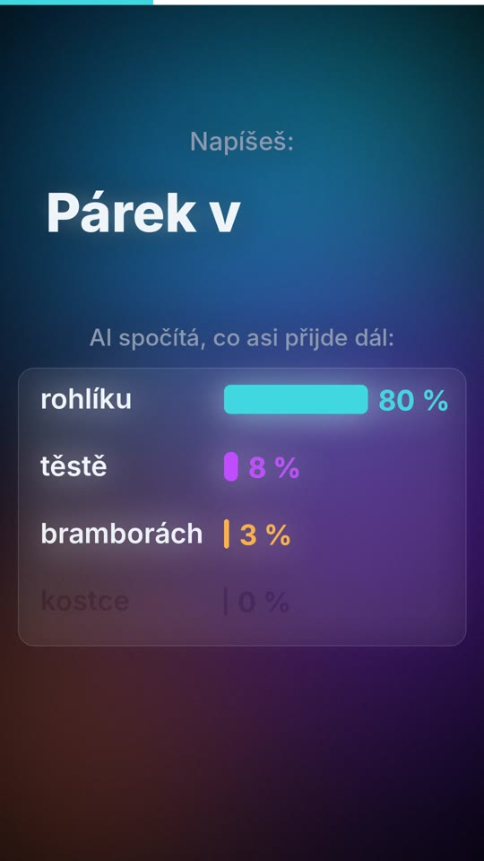
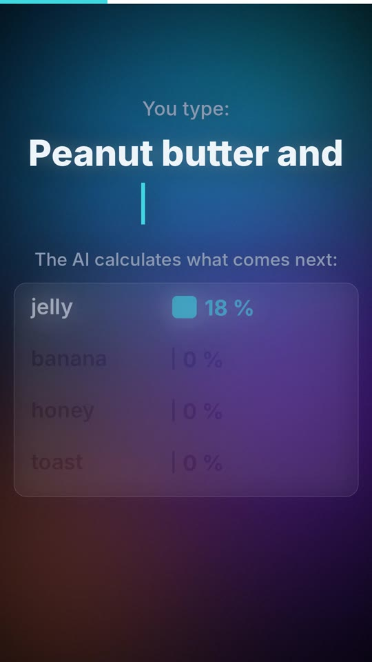
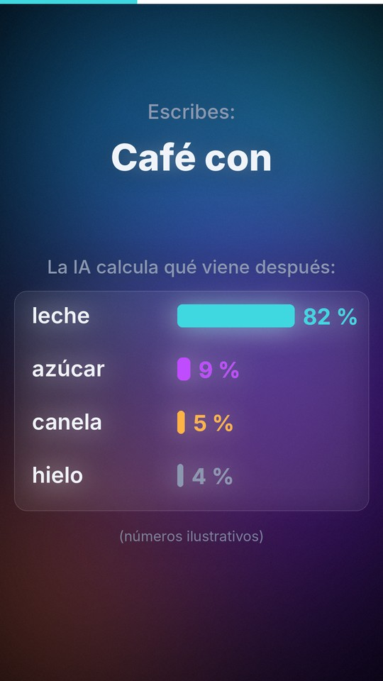
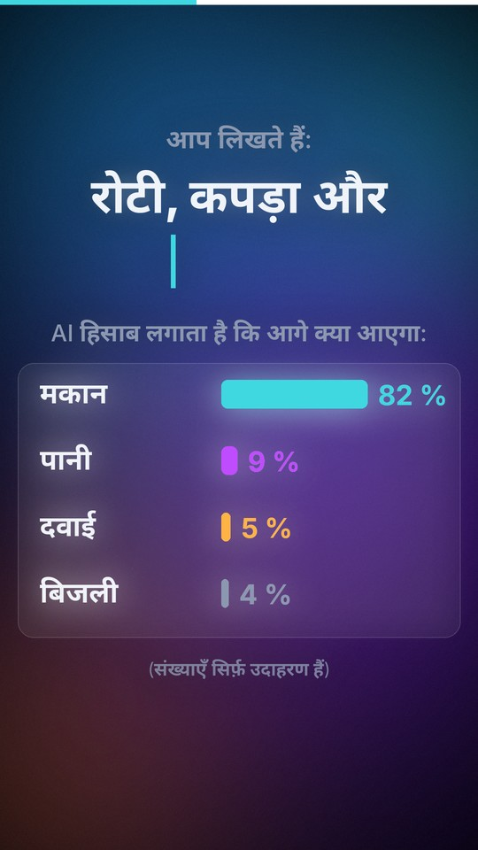
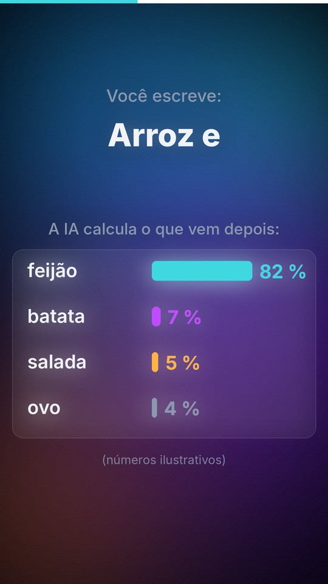

# 01 · Jak „myslí“ AI / How AI thinks / Cómo «piensa» la IA / AI कैसे "सोचता" है / Como a IA “pensa”

| | 🇨🇿 Česky | 🇬🇧 English | 🇪🇸 Español | 🇮🇳 हिन्दी | 🇧🇷 Português |
|---|---|---|---|---|---|
| Video | [01-jak-mysli-ai-CZ.mp4](01-jak-mysli-ai-CZ.mp4) (30 s) | [01-how-ai-thinks-EN.mp4](01-how-ai-thinks-EN.mp4) (33 s) | [01-como-piensa-la-ia-ES.mp4](01-como-piensa-la-ia-ES.mp4) (36 s) | [01-ai-kaise-sochta-hai-HI.mp4](01-ai-kaise-sochta-hai-HI.mp4) (41 s) | [01-como-a-ia-pensa-PT.mp4](01-como-a-ia-pensa-PT.mp4) (33 s) |
| Náhled |  |  |  |  |  |
| Analogie | párek v **rohlíku** | peanut butter and **jelly** | café con **leche** |

**Myšlenka:** AI nemyslí, hádá další slovo. Neví, co je pravda – ví, co obvykle následuje. Proto umí znít přesvědčivě, i když se plete.

## Mluvený text

| Scéna | Česky | English | Español | हिन्दी | Português |
|---|---|---|---|---|---|
| 1 | Jak vlastně myslí umělá inteligence? | How does AI actually think? | ¿Cómo piensa en realidad la inteligencia artificial? | एआई असल में सोचता कैसे है? | Como a inteligência artificial pensa, de verdade? |
| 2 | Nemyslí. Hádá další slovo. | It doesn't. It guesses the next word. | No piensa. Adivina la siguiente palabra. | वह सोचता नहीं है। वह अगले शब्द का अंदाज़ा लगाता है। | Ela não pensa. Ela adivinha a próxima palavra. |
| 3 | Napíšeš „párek v“… a AI spočítá, co asi přijde dál. Nejpravděpodobnější je „rohlíku“, tak ho vybere. | You type "peanut butter and"… and the AI calculates what probably comes next. "Jelly" is the most likely, so it picks it. | Escribes «café con»… y la IA calcula qué viene probablemente después. Lo más probable es «leche», así que la elige. | आप लिखते हैं "रोटी, कपड़ा और"… और एआई हिसाब लगाता है कि आगे शायद क्या आएगा। सबसे ज़्यादा संभावना "मकान" की है, तो वह वही चुन लेता है। | Você escreve “arroz e”… e a IA calcula o que provavelmente vem depois. O mais provável é “feijão”, então ela escolhe essa. |
| 4 | A pak znovu. A znovu. Slovo po slovu tak vznikne celá odpověď. | Then again. And again. Word by word, a whole answer appears. | Y luego otra vez. Y otra. Palabra por palabra, así nace toda la respuesta. | फिर से। और फिर से। शब्द-दर-शब्द, पूरा जवाब बन जाता है। | E depois de novo. E de novo. Palavra por palavra, assim nasce a resposta inteira. |
| 5 | Neví, co je pravda. Ví jen, co obvykle následuje. | It doesn't know what's true. It only knows what usually comes next. | No sabe qué es verdad. Solo sabe qué suele venir después. | उसे नहीं पता कि सच क्या है। उसे बस इतना पता है कि आमतौर पर आगे क्या आता है। | Ela não sabe o que é verdade. Só sabe o que costuma vir depois. |
| 6 | Proto umí znít přesvědčivě, i když se plete. Důležité věci si vždycky ověř. | That's why it can sound convincing even when it's wrong. Always double-check what matters. | Por eso puede sonar convincente aunque se equivoque. Lo importante, compruébalo siempre. | इसीलिए वह गलत होते हुए भी भरोसेमंद लग सकता है। जो बात ज़रूरी हो, उसे हमेशा जाँच लीजिए। | Por isso ela pode soar convincente mesmo quando erra. O que for importante, confira sempre. |

## Soubory

- `zvuk/` – nahrávky z ElevenLabs (CZ: Kuba, EN: George, ES: Brian C, HI: Viraj, PT: Zozo; u hindské i časy písmen v `awaz-HI.casy.json`)
- `zdroj/make.py` – kreslení scén, `zdroj/build.py` – sestavení videí s hlasem, `zdroj/casovani.json` – kde v nahrávce začíná a končí řeč každé scény

---

[← Naučná videa](../README.md)
