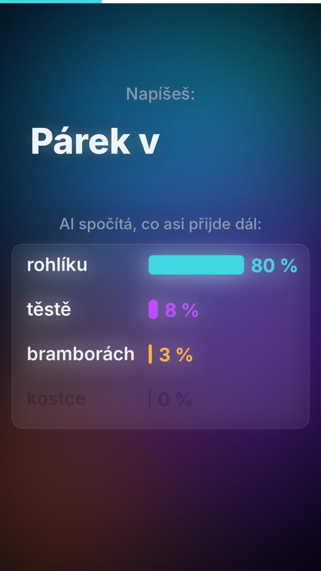
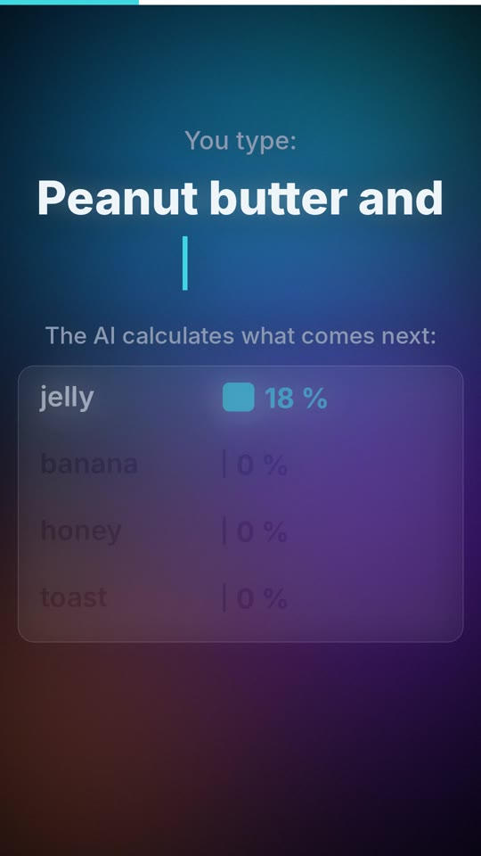

# 01 · Jak „myslí“ AI / How AI thinks

| | 🇨🇿 Česky | 🇬🇧 English |
|---|---|---|
| Video | [01-jak-mysli-ai-CZ.mp4](01-jak-mysli-ai-CZ.mp4) (30 s) | [01-how-ai-thinks-EN.mp4](01-how-ai-thinks-EN.mp4) (33 s) |
| Náhled |  |  |
| Analogie | párek v **rohlíku** | peanut butter and **jelly** |

**Myšlenka:** AI nemyslí, hádá další slovo. Neví, co je pravda – ví, co obvykle následuje. Proto umí znít přesvědčivě, i když se plete.

## Mluvený text

| Scéna | Česky | English |
|---|---|---|
| 1 | Jak vlastně myslí umělá inteligence? | How does AI actually think? |
| 2 | Nemyslí. Hádá další slovo. | It doesn't. It guesses the next word. |
| 3 | Napíšeš „párek v“… a AI spočítá, co asi přijde dál. Nejpravděpodobnější je „rohlíku“, tak ho vybere. | You type "peanut butter and"… and the AI calculates what probably comes next. "Jelly" is the most likely, so it picks it. |
| 4 | A pak znovu. A znovu. Slovo po slovu tak vznikne celá odpověď. | Then again. And again. Word by word, a whole answer appears. |
| 5 | Neví, co je pravda. Ví jen, co obvykle následuje. | It doesn't know what's true. It only knows what usually comes next. |
| 6 | Proto umí znít přesvědčivě, i když se plete. Důležité věci si vždycky ověř. | That's why it can sound convincing even when it's wrong. Always double-check what matters. |

## Soubory

- `zvuk/` – původní nahrávky z ElevenLabs (CZ: Kuba, EN: George)
- `zdroj/make.py` – kreslení scén, `zdroj/build.py` – sestavení videí s hlasem, `zdroj/casovani.json` – kde v nahrávce začíná a končí řeč každé scény

---

[← Naučná videa](../README.md)
