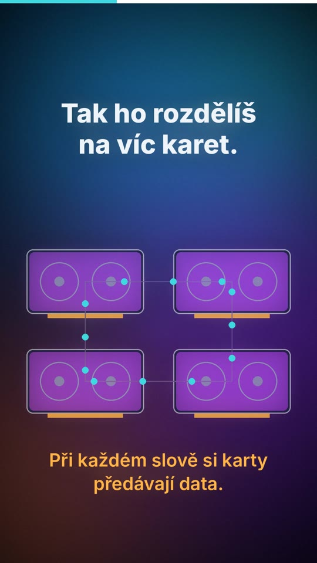
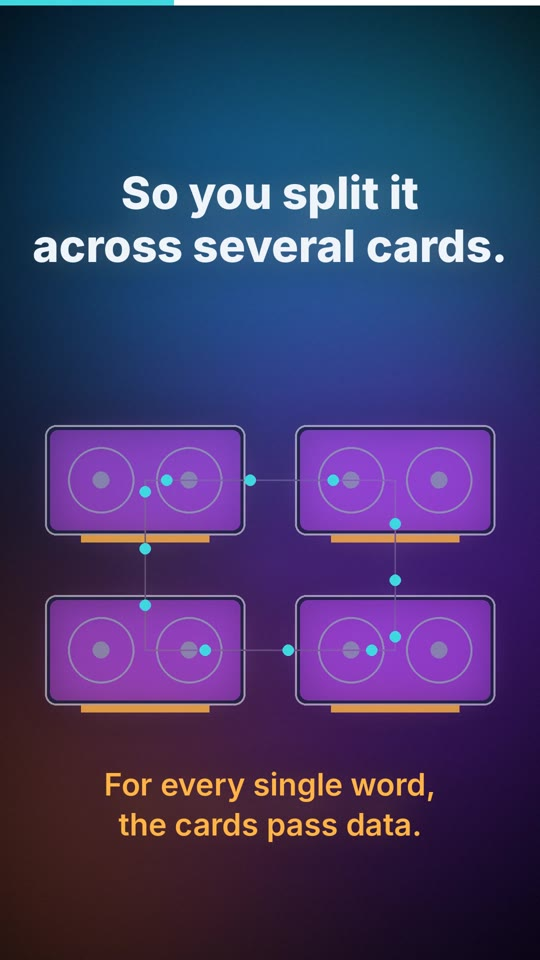

# 02 · Mozek spojený provázkem / A brain tied with string

| | 🇨🇿 Česky | 🇬🇧 English |
|---|---|---|
| Video | [02-mozek-spojeny-provazkem-CZ.mp4](02-mozek-spojeny-provazkem-CZ.mp4) (32 s) | [02-brain-tied-with-string-EN.mp4](02-brain-tied-with-string-EN.mp4) (37 s) |
| Náhled |  |  |

**Myšlenka:** Velký model se nevejde do jedné grafické karty. Rozdělený na víc karet si musí při každém slově předávat data – doma přes základní desku („provázek“), v datovém centru přes vlastní superrychlé propojení.

## Mluvený text

| Scéna | Česky | English |
|---|---|---|
| 1 | Proč si doma nepostavíš vlastní velkou AI? | Why can't you build your own big AI at home? |
| 2 | Velký model je obří. Nevejde se do jedné grafické karty. | A big model is huge. It doesn't fit on one graphics card. |
| 3 | Tak ho rozdělíš na víc karet. Jenže při každém slově si karty musí předávat data. | So you split it across several cards. But for every single word, the cards have to pass data to each other. |
| 4 | Doma je spojuje základní deska. To je, jako bys rozřízl mozek a spojil ho provázkem. | At home, they talk through the motherboard. It's like cutting a brain in half and tying it back together with string. |
| 5 | V datovém centru mají karty vlastní superrychlé propojení. Mozek drží pohromadě. | In a data center, the cards have their own super-fast links. The brain stays in one piece. |
| 6 | Proto ty největší modely běží v datových centrech. A doma zatím běží ty menší. | That's why the biggest models live in data centers. And at home, for now, we run the smaller ones. |

## Soubory

`zvuk/` nahrávky z ElevenLabs (Kuba / George) · `zdroj/make.py` scény · `zdroj/build.py` sestavení · `zdroj/casovani.json` časování řeči

---

[← Naučná videa](../README.md)
