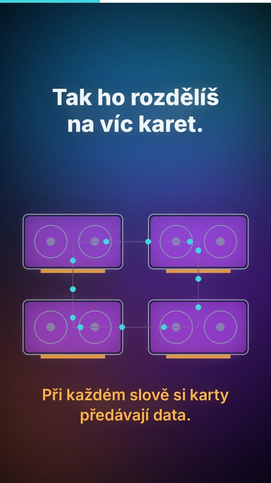
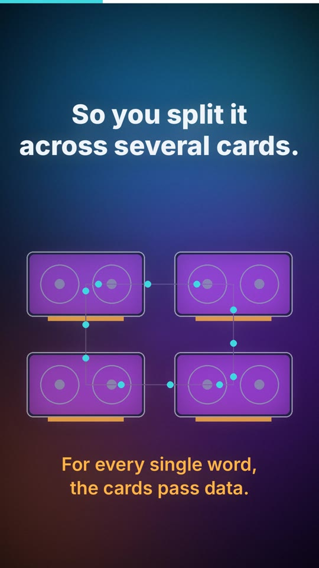
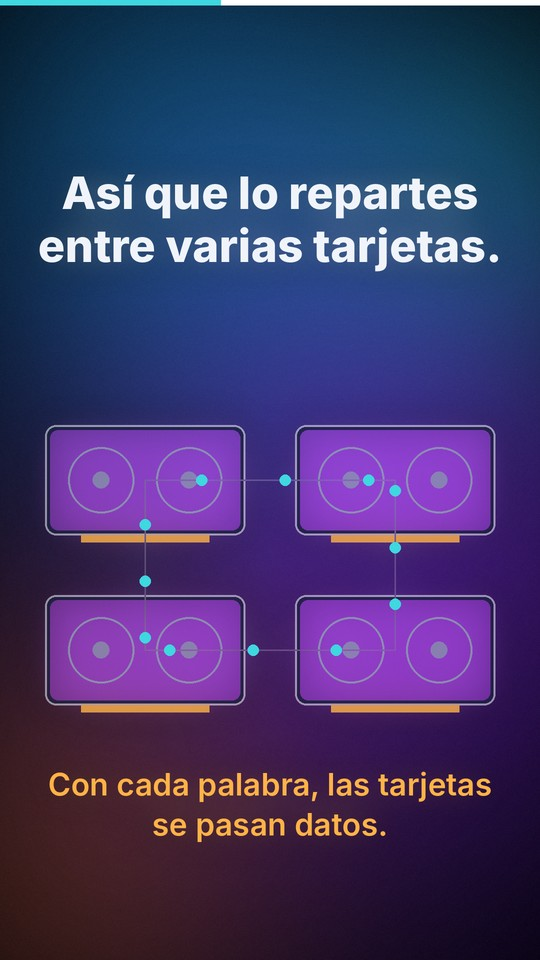
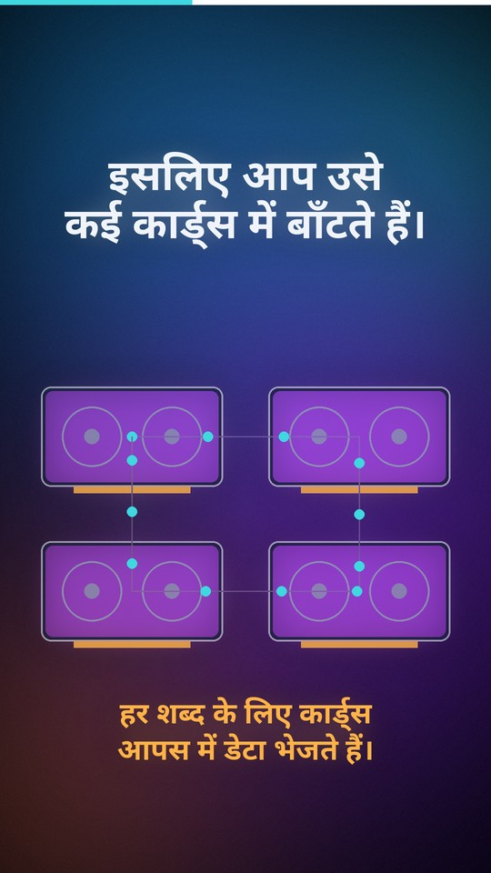

# 02 · Mozek spojený provázkem / A brain tied with string / Un cerebro atado con un cordel / धागे से जुड़ा दिमाग

| | 🇨🇿 Česky | 🇬🇧 English | 🇪🇸 Español | 🇮🇳 हिन्दी |
|---|---|---|---|---|
| Video | [02-mozek-spojeny-provazkem-CZ.mp4](02-mozek-spojeny-provazkem-CZ.mp4) (32 s) | [02-brain-tied-with-string-EN.mp4](02-brain-tied-with-string-EN.mp4) (37 s) | [02-un-cerebro-atado-con-un-cordel-ES.mp4](02-un-cerebro-atado-con-un-cordel-ES.mp4) (39 s) | [02-dhaage-se-juda-dimaag-HI.mp4](02-dhaage-se-juda-dimaag-HI.mp4) (42 s) |
| Náhled |  |  |  |  |

**Myšlenka:** Velký model se nevejde do jedné grafické karty. Rozdělený na víc karet si musí při každém slově předávat data – doma přes základní desku („provázek“), v datovém centru přes vlastní superrychlé propojení.

## Mluvený text

| Scéna | Česky | English | Español | हिन्दी |
|---|---|---|---|---|
| 1 | Proč si doma nepostavíš vlastní velkou AI? | Why can't you build your own big AI at home? | ¿Por qué no puedes armar en casa tu propia IA grande? | आप घर पर अपना बड़ा एआई क्यों नहीं बना सकते? |
| 2 | Velký model je obří. Nevejde se do jedné grafické karty. | A big model is huge. It doesn't fit on one graphics card. | Un modelo grande es enorme. No cabe en una sola tarjeta gráfica. | बड़ा मॉडल बहुत विशाल होता है। वह एक ग्राफ़िक्स कार्ड में नहीं समाता। |
| 3 | Tak ho rozdělíš na víc karet. Jenže při každém slově si karty musí předávat data. | So you split it across several cards. But for every single word, the cards have to pass data to each other. | Así que lo repartes entre varias tarjetas. Pero con cada palabra, las tarjetas tienen que pasarse datos entre sí. | इसलिए आप उसे कई कार्ड्स में बाँट देते हैं। लेकिन हर एक शब्द के लिए कार्ड्स को आपस में डेटा भेजना पड़ता है। |
| 4 | Doma je spojuje základní deska. To je, jako bys rozřízl mozek a spojil ho provázkem. | At home, they talk through the motherboard. It's like cutting a brain in half and tying it back together with string. | En casa, las conecta la placa madre. Es como partir un cerebro en dos y volver a unirlo con un cordel. | घर पर वे मदरबोर्ड के ज़रिए बात करते हैं। यह ऐसा है, जैसे दिमाग को दो हिस्सों में काटकर धागे से वापस जोड़ दिया जाए। |
| 5 | V datovém centru mají karty vlastní superrychlé propojení. Mozek drží pohromadě. | In a data center, the cards have their own super-fast links. The brain stays in one piece. | En un centro de datos, las tarjetas tienen sus propias conexiones ultrarrápidas. El cerebro sigue entero. | डेटा सेंटर में कार्ड्स के अपने बेहद तेज़ कनेक्शन होते हैं। दिमाग एक टुकड़े में बना रहता है। |
| 6 | Proto ty největší modely běží v datových centrech. A doma zatím běží ty menší. | That's why the biggest models live in data centers. And at home, for now, we run the smaller ones. | Por eso los modelos más grandes viven en centros de datos. Y en casa, de momento, usamos los más pequeños. | इसीलिए सबसे बड़े मॉडल डेटा सेंटर में रहते हैं। और घर पर, फ़िलहाल, हम छोटे मॉडल चलाते हैं। |

## Soubory

`zvuk/` nahrávky z ElevenLabs (Kuba / George / Brian C / Viraj; u hindské nahrávky i časy písmen v `awaz-HI.casy.json`) · `zdroj/make.py` scény · `zdroj/build.py` sestavení · `zdroj/casovani.json` časování řeči

---

[← Naučná videa](../README.md)
