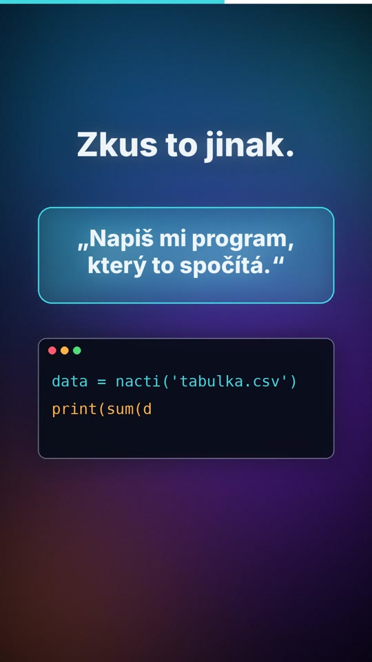
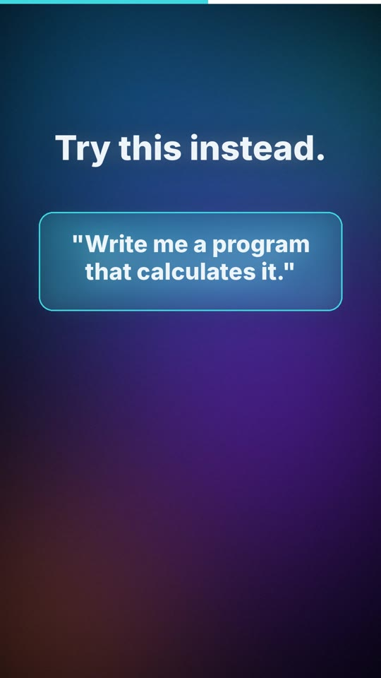

# 03 · Nech AI postavit kalkulačku / Have AI build the calculator

| | 🇨🇿 Česky | 🇬🇧 English |
|---|---|---|
| Video | [03-nech-ai-postavit-kalkulacku-CZ.mp4](03-nech-ai-postavit-kalkulacku-CZ.mp4) (31 s) | [03-have-ai-build-the-calculator-EN.mp4](03-have-ai-build-the-calculator-EN.mp4) (35 s) |
| Náhled |  |  |

**Myšlenka:** Jazykový model nepočítá jako kalkulačka, odhaduje, jak vypadá správná odpověď – u velké tabulky se snadno splete. Lepší je nechat ho napsat program: ten se jednou zkontroluje a pak počítá přesně, pokaždé stejně.

## Mluvený text

| Scéna | Česky | English |
|---|---|---|
| 1 | Chceš, aby AI spočítala tvoje data? | Want AI to crunch your numbers? |
| 2 | Má to háček. Jazykový model nepočítá jako kalkulačka. Odhaduje, jak vypadá správná odpověď. | There's a catch. A language model doesn't calculate like a calculator. It predicts what the right answer looks like. |
| 3 | U velké tabulky se pak snadno splete. A na první pohled to nepoznáš. | With a big spreadsheet, it can easily slip. And at first glance, you won't notice. |
| 4 | Zkus to jinak. Řekni mu: napiš mi program, který to spočítá. | Try this instead. Tell it: write me a program that calculates it. |
| 5 | Program si jednou zkontroluješ. Pak počítá přesně, pokaždé stejně. A zůstane ti. | You check the program once. Then it calculates exactly, the same way every time. And you get to keep it. |
| 6 | AI tedy nemá dělat kalkulačku. Má ti ji postavit. | So don't make AI be your calculator. Have it build you one. |

## Soubory

`zvuk/` nahrávky z ElevenLabs (Kuba / George) · `zdroj/make.py` scény · `zdroj/build.py` sestavení · `zdroj/casovani.json` časování řeči

---

[← Naučná videa](../README.md)
