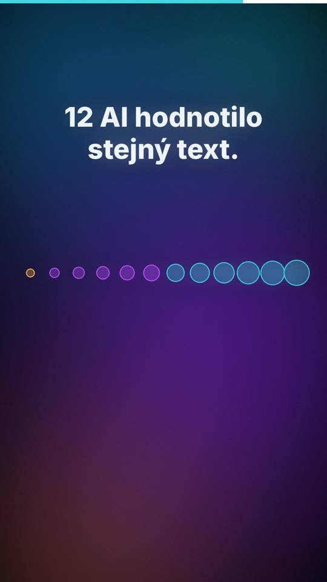
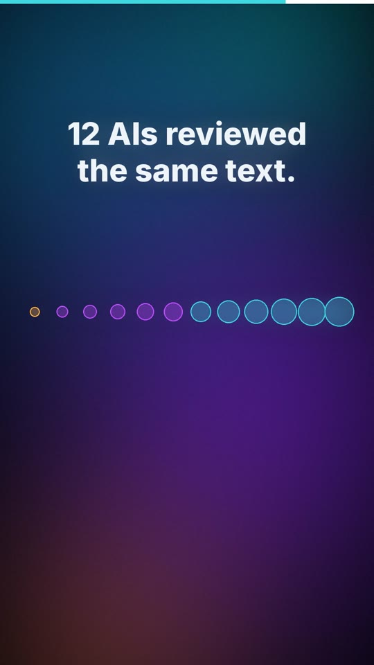
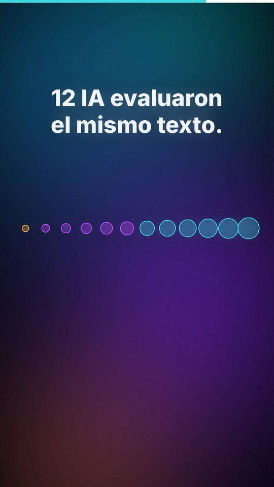

# 04 · Kecálek vs. vidí za roh / Chatterbox vs. sees around corners / Parlanchín vs. ve más allá

| | 🇨🇿 Česky | 🇬🇧 English | 🇪🇸 Español |
|---|---|---|---|
| Video | [04-kecalek-vs-vidi-za-roh-CZ.mp4](04-kecalek-vs-vidi-za-roh-CZ.mp4) (41 s) | [04-chatterbox-vs-sees-around-corners-EN.mp4](04-chatterbox-vs-sees-around-corners-EN.mp4) (45 s) | [04-parlanchin-vs-ve-mas-alla-ES.mp4](04-parlanchin-vs-ve-mas-alla-ES.mp4) (50 s) |
| Náhled |  |  |  |

**Myšlenka:** Modely mají různou velikost a s ní roste, co zvládnou. Malý je rychlý, ale domýšlí si; střední umí programovat, ale víc zkouší; největší vidí souvislosti a chyby. Experiment: z dvanácti AI recenzentů dala nejmenší nejlepší známku a nenašla jedinou chybu.

## Mluvený text

| Scéna | Česky | English | Español |
|---|---|---|---|
| 1 | Je každá AI stejně chytrá? | Is every AI equally smart? | ¿Todas las IA son igual de inteligentes? |
| 2 | Není. Modely mají různou velikost. A s ní roste i to, co zvládnou. | No. Models come in different sizes. And what they can handle grows with them. | No. Los modelos tienen distintos tamaños. Y con el tamaño crece lo que son capaces de hacer. |
| 3 | Malý model se vejde do jedné herní karty. Je rychlý, ale je to kecálek. Domýšlí si. | A small model fits on one gaming card. It's fast, but it's a chatterbox. It makes things up. | Un modelo pequeño cabe en una sola tarjeta gráfica para juegos. Es rápido, pero es un parlanchín. Se inventa cosas. |
| 4 | Střední model na pár kartách už umí programovat. Jen víc zkouší a opravuje. | A mid-size model on a few cards can already write code. It just tries and fixes things more often. | Un modelo mediano, en unas cuantas tarjetas, ya sabe programar. Solo que prueba y corrige más veces. |
| 5 | A ty největší v datových centrech vidí za roh. Najdou souvislosti a chyby, které malé přehlédnou. | And the biggest ones, in data centers, can see around corners. They catch connections and mistakes the small ones miss. | Y los más grandes, en centros de datos, ven más allá. Encuentran conexiones y errores que a los pequeños se les escapan. |
| 6 | Zkusil jsem to. Dvanáct AI hodnotilo stejný text. Nejmenší dala nejlepší známku. A nenašla jedinou chybu. | I tried it. Twelve AIs reviewed the same text. The smallest one gave the highest score. And it didn't find a single flaw. | Lo probé. Doce IA evaluaron el mismo texto. La más pequeña le puso la nota más alta. Y no encontró ni un solo error. |
| 7 | Takže čím menší model, tím víc si jeho odpovědi ověřuj. | So the smaller the model, the more you should double-check its answers. | Así que, cuanto más pequeño sea el modelo, más debes comprobar sus respuestas. |

## Soubory

`zvuk/` nahrávky z ElevenLabs (Kuba / George) · `zdroj/make.py` scény · `zdroj/build.py` sestavení · `zdroj/casovani.json` časování řeči

---

[← Naučná videa](../README.md)
