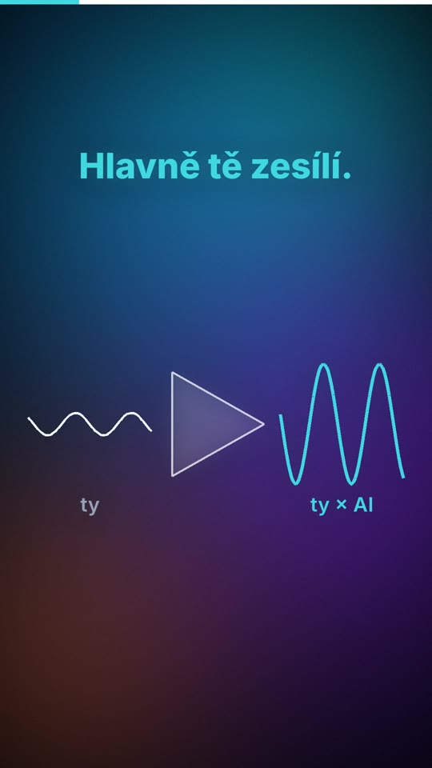
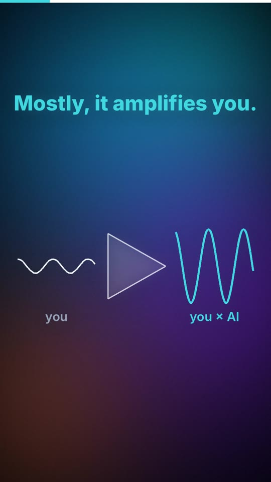

# 05 · AI je zesilovač / AI is an amplifier

| | 🇨🇿 Česky | 🇬🇧 English |
|---|---|---|
| Video | [05-ai-je-zesilovac-CZ.mp4](05-ai-je-zesilovac-CZ.mp4) (33 s) | [05-ai-is-an-amplifier-EN.mp4](05-ai-is-an-amplifier-EN.mp4) (35 s) |
| Náhled |  |  |

**Myšlenka:** AI funguje jako zesilovač – zesílí všechno, co do ní pustíš: znalost oboru a jasný cíl, ale i zmatek a chyby. Směr musí dodat člověk.

## Mluvený text

| Scéna | Česky | English |
|---|---|---|
| 1 | Co s tebou vlastně udělá AI? | What does AI actually do to you? |
| 2 | Hlavně tě zesílí. Funguje jako zesilovač. Zesílí všechno, co do ní pustíš. | Mostly, it amplifies you. Like an amplifier, it boosts whatever you feed into it. |
| 3 | Když víš, co chceš, a rozumíš svému oboru, zvládneš za hodiny, co dřív trvalo týdny. | If you know what you want and you know your field, you'll do in hours what used to take weeks. |
| 4 | Když nevíš, kam jdeš, zesílí ti zmatek. Dostaneš hromadu textu a nic z toho nebude. | If you don't know where you're going, it amplifies the chaos. You get piles of text, and nothing comes of it. |
| 5 | A zesílí i tvoje chyby. Špatné zadání se rozroste rychleji než kdy dřív. | And it amplifies your mistakes, too. A bad brief grows faster than ever. |
| 6 | Takže než ji zapneš, ujasni si směr. Ten musíš dodat ty. | So before you switch it on, know your direction. That part has to come from you. |

## Soubory

`zvuk/` nahrávky z ElevenLabs (Kuba / George) · `zdroj/make.py` scény · `zdroj/build.py` sestavení · `zdroj/casovani.json` časování řeči

---

[← Naučná videa](../README.md)
