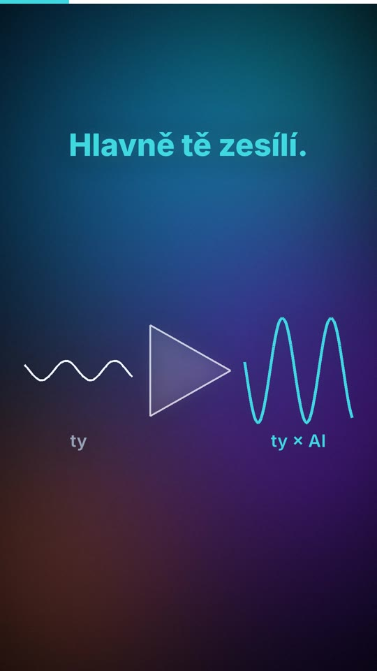
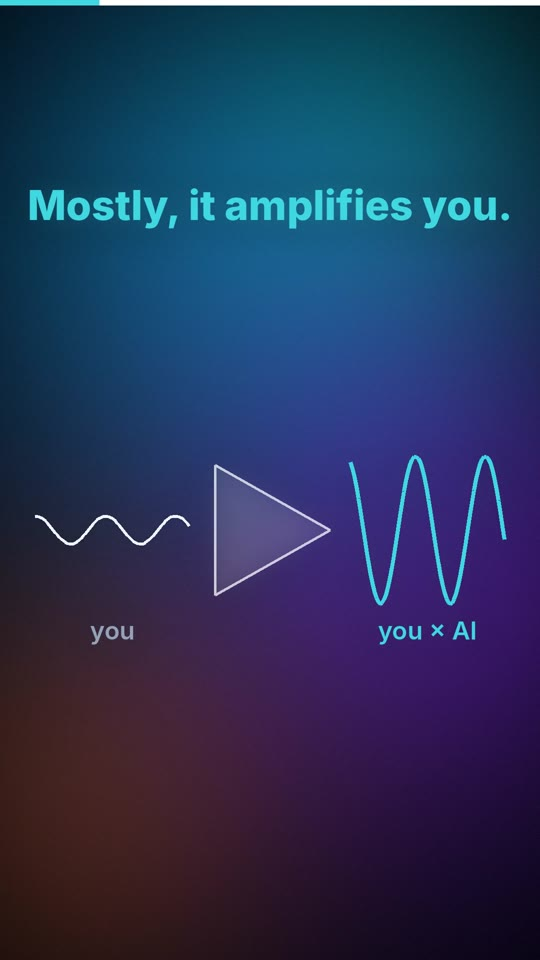
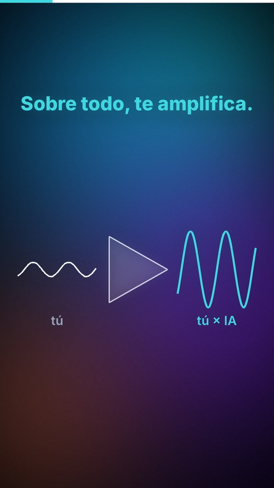
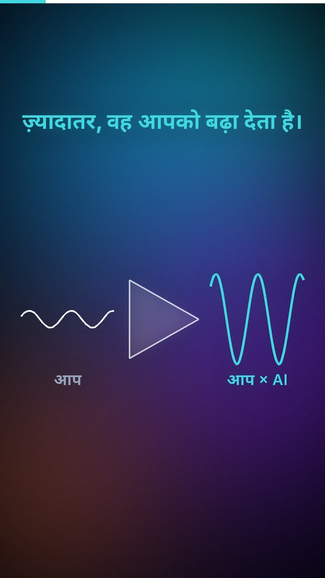

# 05 · AI je zesilovač / AI is an amplifier / La IA es un amplificador / AI एक एम्पलीफ़ायर है

| | 🇨🇿 Česky | 🇬🇧 English | 🇪🇸 Español | 🇮🇳 हिन्दी |
|---|---|---|---|---|
| Video | [05-ai-je-zesilovac-CZ.mp4](05-ai-je-zesilovac-CZ.mp4) (33 s) | [05-ai-is-an-amplifier-EN.mp4](05-ai-is-an-amplifier-EN.mp4) (35 s) | [05-la-ia-es-un-amplificador-ES.mp4](05-la-ia-es-un-amplificador-ES.mp4) (37 s) | [05-ai-ek-amplifier-hai-HI.mp4](05-ai-ek-amplifier-hai-HI.mp4) (48 s) |
| Náhled |  |  |  |  |

**Myšlenka:** AI funguje jako zesilovač – zesílí všechno, co do ní pustíš: znalost oboru a jasný cíl, ale i zmatek a chyby. Směr musí dodat člověk.

## Mluvený text

| Scéna | Česky | English | Español | हिन्दी |
|---|---|---|---|---|
| 1 | Co s tebou vlastně udělá AI? | What does AI actually do to you? | ¿Qué hace la IA contigo, en realidad? | एआई असल में आपके साथ क्या करता है? |
| 2 | Hlavně tě zesílí. Funguje jako zesilovač. Zesílí všechno, co do ní pustíš. | Mostly, it amplifies you. Like an amplifier, it boosts whatever you feed into it. | Sobre todo, te amplifica. Funciona como un amplificador: amplifica todo lo que le metes. | ज़्यादातर, वह आपको कई गुना बढ़ा देता है। एम्पलीफ़ायर की तरह, आप जो भी उसमें डालते हैं, उसे वह और ज़ोरदार बना देता है। |
| 3 | Když víš, co chceš, a rozumíš svému oboru, zvládneš za hodiny, co dřív trvalo týdny. | If you know what you want and you know your field, you'll do in hours what used to take weeks. | Si sabes lo que quieres y conoces tu campo, harás en horas lo que antes tomaba semanas. | अगर आपको पता है कि आप क्या चाहते हैं और आप अपने क्षेत्र को जानते हैं, तो जो काम पहले हफ़्तों में होता था, वह घंटों में हो जाएगा। |
| 4 | Když nevíš, kam jdeš, zesílí ti zmatek. Dostaneš hromadu textu a nic z toho nebude. | If you don't know where you're going, it amplifies the chaos. You get piles of text, and nothing comes of it. | Si no sabes adónde vas, te amplifica el caos. Obtienes montones de texto, y de ahí no sale nada. | अगर आपको नहीं पता कि आप कहाँ जा रहे हैं, तो वह अव्यवस्था को कई गुना बढ़ा देता है। आपको ढेर सारा टेक्स्ट मिलता है, और उससे कुछ नहीं निकलता। |
| 5 | A zesílí i tvoje chyby. Špatné zadání se rozroste rychleji než kdy dřív. | And it amplifies your mistakes, too. A bad brief grows faster than ever. | Y también amplifica tus errores. Unas malas instrucciones se multiplican más rápido que nunca. | और वह आपकी गलतियों को भी बढ़ाता है। गलत निर्देश पहले से कहीं ज़्यादा तेज़ी से फैलते हैं। |
| 6 | Takže než ji zapneš, ujasni si směr. Ten musíš dodat ty. | So before you switch it on, know your direction. That part has to come from you. | Así que, antes de encenderla, ten clara la dirección. Esa la tienes que poner tú. | तो इसे चालू करने से पहले, अपनी दिशा तय कर लीजिए। वह हिस्सा आपको ही देना होगा। |

## Soubory

`zvuk/` nahrávky z ElevenLabs (Kuba / George / Brian C / Viraj; u hindské nahrávky i časy písmen v `awaz-HI.casy.json`) · `zdroj/make.py` scény · `zdroj/build.py` sestavení · `zdroj/casovani.json` časování řeči

---

[← Naučná videa](../README.md)
