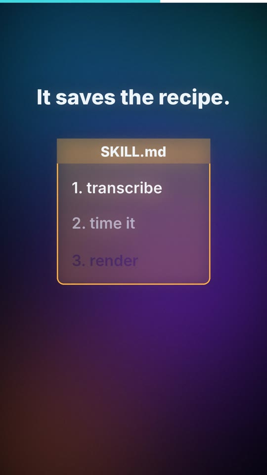

# 06 · Co je AI agent / What is an AI agent

| | 🇨🇿 Česky | 🇬🇧 English |
|---|---|---|
| Video | [06-co-je-ai-agent-CZ.mp4](06-co-je-ai-agent-CZ.mp4) (35 s) | [06-what-is-an-ai-agent-EN.mp4](06-what-is-an-ai-agent-EN.mp4) (39 s) |
| Náhled |  |  |

**Myšlenka:** Jazykový model je jen mozek – chytrý, ale bez rukou a paměti. Agent mu dá nástroje, paměť a uložené postupy (skilly) a sám zkouší, kontroluje a opravuje, dokud nesplní cíl. Jde přesně tam, kam ho nasměruješ.

## Mluvený text

| Scéna | Česky | English |
|---|---|---|
| 1 | Co je vlastně AI agent? | What actually is an AI agent? |
| 2 | Samotný jazykový model je jen mozek. Chytrý, ale nemá ruce ani paměť. | A language model on its own is just a brain. Smart, but no hands and no memory. |
| 3 | Agent mu dá nástroje. Může hledat na webu, psát soubory, spouštět programy. | An agent gives it tools. It can search the web, write files, run programs. |
| 4 | Dá mu paměť. Důležité věci si zapíše a příště je ví. | It gives it memory. It writes down what matters and remembers it next time. |
| 5 | A když se mu něco povede, uloží si postup. Říká se tomu skill. | And when something works, it saves the recipe. That's called a skill. |
| 6 | Agent pak sám zkouší, kontroluje a opravuje, dokud nesplní cíl. | Then the agent tries, checks and fixes things on its own, until the goal is done. |
| 7 | Jen pozor: jde přesně tam, kam ho nasměruješ. Tak ho nasměruj dobře. | Just be careful: it goes exactly where you point it. So point it well. |

## Soubory

`zvuk/` nahrávky z ElevenLabs (Kuba / George) · `zdroj/make.py` scény · `zdroj/build.py` sestavení · `zdroj/casovani.json` časování řeči · `scenar.md` původní scénář

---

[← Naučná videa](../README.md)
