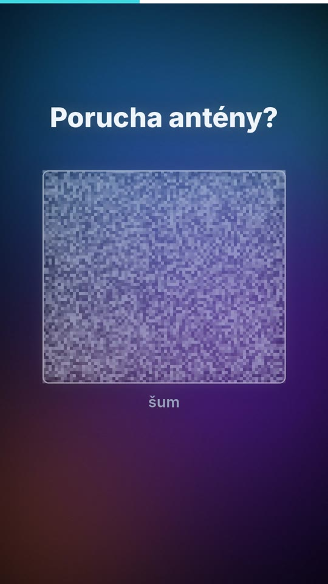
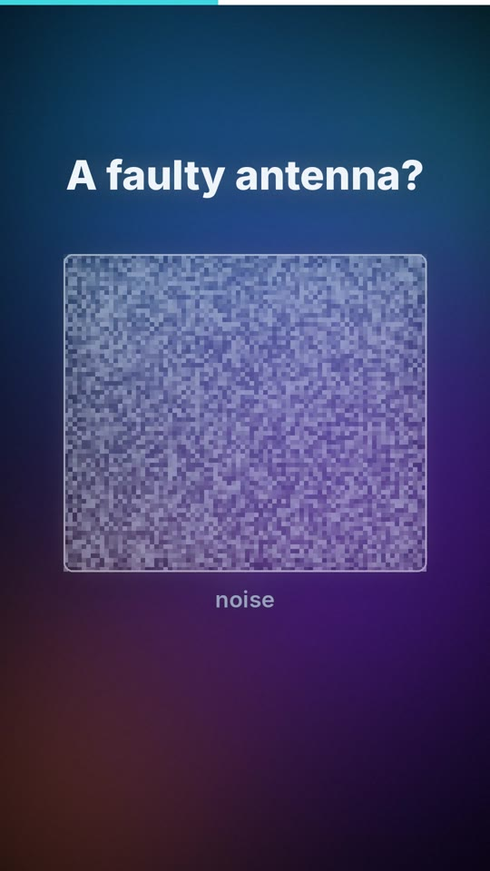
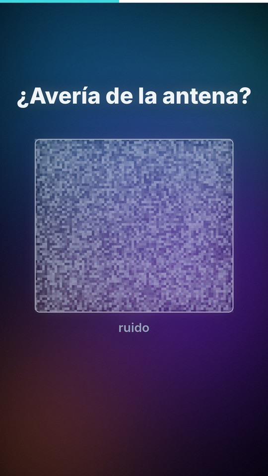
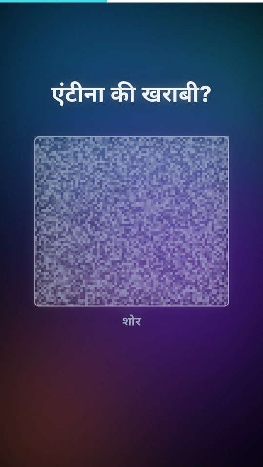
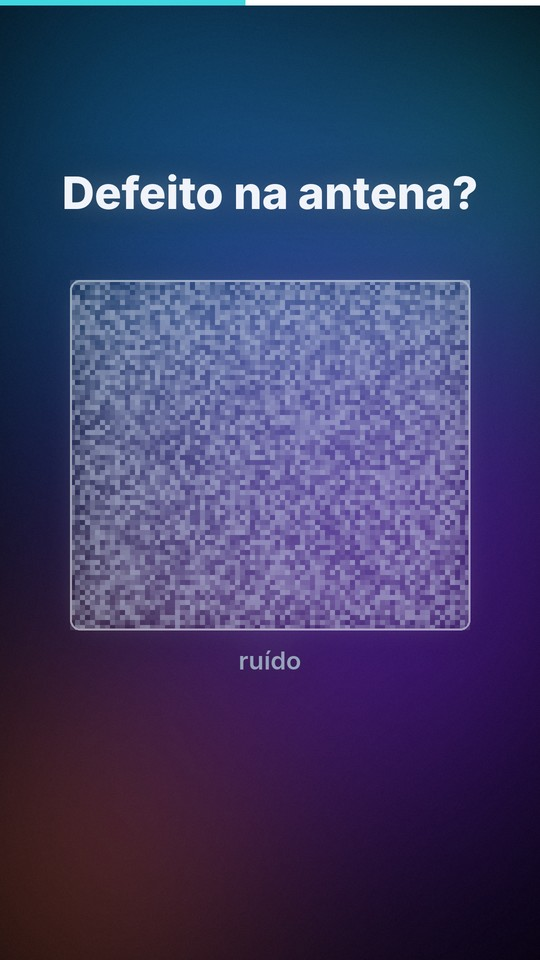

# 07 · Naše „nic“ není důkaz / Our “nothing” is not proof / Nuestra «nada» no es una prueba / हमारा "कुछ नहीं" सबूत नहीं है / O nosso “nada” não é prova

| | 🇨🇿 Česky | 🇬🇧 English | 🇪🇸 Español | 🇮🇳 हिन्दी | 🇧🇷 Português |
|---|---|---|---|---|---|
| Video | [07-nase-nic-neni-dukaz-CZ.mp4](07-nase-nic-neni-dukaz-CZ.mp4) (39 s) | [07-our-nothing-is-not-proof-EN.mp4](07-our-nothing-is-not-proof-EN.mp4) (39 s) | [07-nuestra-nada-no-es-una-prueba-ES.mp4](07-nuestra-nada-no-es-una-prueba-ES.mp4) (47 s) | [07-hamara-kuch-nahin-saboot-nahin-HI.mp4](07-hamara-kuch-nahin-saboot-nahin-HI.mp4) (50 s) | [07-o-nosso-nada-nao-e-prova-PT.mp4](07-o-nosso-nada-nao-e-prova-PT.mp4) (41 s) |
| Náhled |  |  |  |  |  |

**Myšlenka:** To, že něco nevidíme, často jen znamená, že na to nemáme nástroj (rádiové vlny, reliktní záření považované za poruchu antény). AI umí najít vzory, které člověk přehlédne – ale i vzory, které neexistují. Proto každý objev potřebuje ověření.

## Mluvený text

| Scéna | Česky | English | Español | हिन्दी | Português |
|---|---|---|---|---|---|
| 1 | Když něco nevidíme, znamená to, že to neexistuje? | If we can't see something, does that mean it isn't there? | Si no podemos ver algo, ¿significa que no existe? | अगर हम कुछ देख नहीं सकते, तो क्या इसका मतलब है कि वह है ही नहीं? | Se a gente não consegue ver alguma coisa, isso significa que ela não existe? |
| 2 | Ne vždycky. Rádiové vlny tu byly odjakživa. Jen jsme neměli přístroj, který by je zachytil. | Not always. Radio waves were always here. We just had no device to pick them up. | No siempre. Las ondas de radio siempre estuvieron aquí. Solo que no teníamos un aparato para captarlas. | हमेशा नहीं। रेडियो तरंगें हमेशा से यहाँ थीं। बस हमारे पास उन्हें पकड़ने वाला यंत्र नहीं था। | Nem sempre. As ondas de rádio sempre estiveram aqui. A gente só não tinha um aparelho para captá-las. |
| 3 | Záření z počátku vesmíru vědci nejdřív považovali za poruchu antény. Byl to šum, dokud se někdo nezeptal: co když to není šum? | The afterglow of the early universe was first mistaken for a faulty antenna. It was just noise, until someone asked: what if it isn't? | Al principio, los científicos confundieron el resplandor del universo primitivo con una avería de la antena. Era solo ruido, hasta que alguien preguntó: ¿y si no es ruido? | शुरुआती ब्रह्मांड की चमक को पहले एंटीना की खराबी समझा गया। वह बस शोर था, जब तक किसी ने नहीं पूछा: अगर यह शोर न हो तो? | No começo, os cientistas confundiram o brilho do universo primitivo com um defeito na antena. Era só ruído, até alguém perguntar: e se não for ruído? |
| 4 | Naše „nic“ často není důkaz, že něco neexistuje. Je to důkaz, že na to nemáme nástroj. | Our "nothing" often isn't proof that something doesn't exist. It's proof we don't have the tool to see it. | Nuestra «nada» muchas veces no prueba que algo no exista. Prueba que no tenemos la herramienta para verlo. | हमारा "कुछ नहीं" अक्सर इस बात का सबूत नहीं होता कि कुछ मौजूद नहीं है। यह सबूत है कि हमारे पास उसे देखने का औज़ार नहीं है। | O nosso “nada” muitas vezes não prova que algo não existe. Prova que não temos a ferramenta para ver. |
| 5 | AI umí v obrovských datech hledat vzory, které člověk přehlédne. | AI can search huge amounts of data for patterns people miss. | La IA puede buscar en cantidades enormes de datos patrones que a las personas se les escapan. | एआई विशाल डेटा में ऐसे पैटर्न खोज सकता है, जो इंसानों से छूट जाते हैं। | A IA consegue encontrar, em quantidades enormes de dados, padrões que escapam às pessoas. |
| 6 | Jenže umí najít i vzor, který tam vůbec není. Proto každý objev potřebuje ověření. | But it can also find a pattern that isn't there at all. That's why every discovery needs checking. | Pero también puede encontrar un patrón que ni siquiera existe. Por eso todo descubrimiento necesita verificarse. | लेकिन वह ऐसा पैटर्न भी ढूँढ सकता है, जो है ही नहीं। इसीलिए हर खोज की जाँच ज़रूरी है। | Mas ela também pode encontrar um padrão que nem existe. Por isso toda descoberta precisa ser verificada. |

## Soubory

`zvuk/` nahrávky z ElevenLabs (Kuba / George / Brian C / Viraj / Zozo; u nahrávek z workflow Namluvit i časy písmen v `*.casy.json`) · `zdroj/make.py` scény · `zdroj/build.py` sestavení · `zdroj/casovani.json` časování řeči · `scenar.md` původní scénář

---

[← Naučná videa](../README.md)
