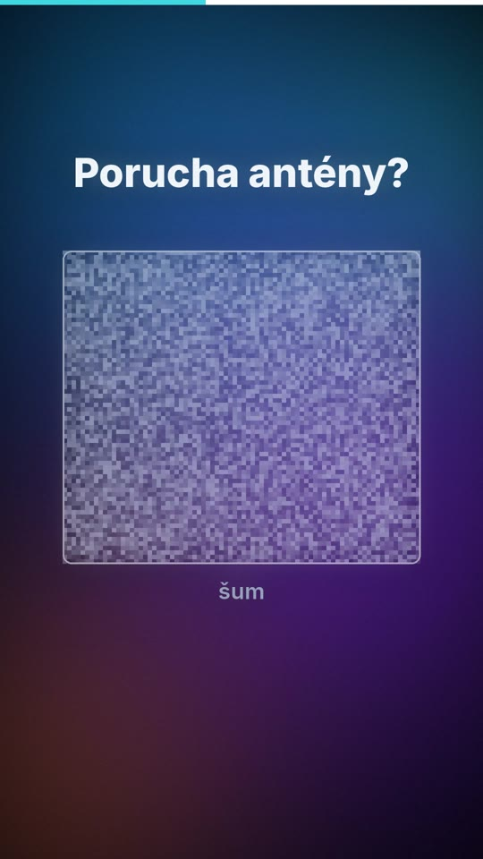
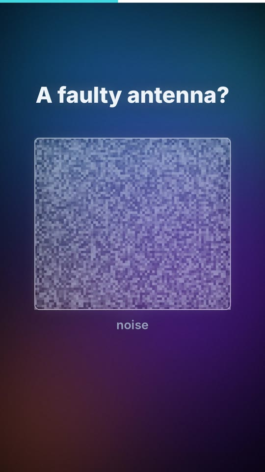

# 07 · Naše „nic“ není důkaz / Our “nothing” is not proof

| | 🇨🇿 Česky | 🇬🇧 English |
|---|---|---|
| Video | [07-nase-nic-neni-dukaz-CZ.mp4](07-nase-nic-neni-dukaz-CZ.mp4) (39 s) | [07-our-nothing-is-not-proof-EN.mp4](07-our-nothing-is-not-proof-EN.mp4) (39 s) |
| Náhled |  |  |

**Myšlenka:** To, že něco nevidíme, často jen znamená, že na to nemáme nástroj (rádiové vlny, reliktní záření považované za poruchu antény). AI umí najít vzory, které člověk přehlédne – ale i vzory, které neexistují. Proto každý objev potřebuje ověření.

## Mluvený text

| Scéna | Česky | English |
|---|---|---|
| 1 | Když něco nevidíme, znamená to, že to neexistuje? | If we can't see something, does that mean it isn't there? |
| 2 | Ne vždycky. Rádiové vlny tu byly odjakživa. Jen jsme neměli přístroj, který by je zachytil. | Not always. Radio waves were always here. We just had no device to pick them up. |
| 3 | Záření z počátku vesmíru vědci nejdřív považovali za poruchu antény. Byl to šum, dokud se někdo nezeptal: co když to není šum? | The afterglow of the early universe was first mistaken for a faulty antenna. It was just noise, until someone asked: what if it isn't? |
| 4 | Naše „nic“ často není důkaz, že něco neexistuje. Je to důkaz, že na to nemáme nástroj. | Our "nothing" often isn't proof that something doesn't exist. It's proof we don't have the tool to see it. |
| 5 | AI umí v obrovských datech hledat vzory, které člověk přehlédne. | AI can search huge amounts of data for patterns people miss. |
| 6 | Jenže umí najít i vzor, který tam vůbec není. Proto každý objev potřebuje ověření. | But it can also find a pattern that isn't there at all. That's why every discovery needs checking. |

## Soubory

`zvuk/` nahrávky z ElevenLabs (Kuba / George) · `zdroj/make.py` scény · `zdroj/build.py` sestavení · `zdroj/casovani.json` časování řeči · `scenar.md` původní scénář

---

[← Naučná videa](../README.md)
