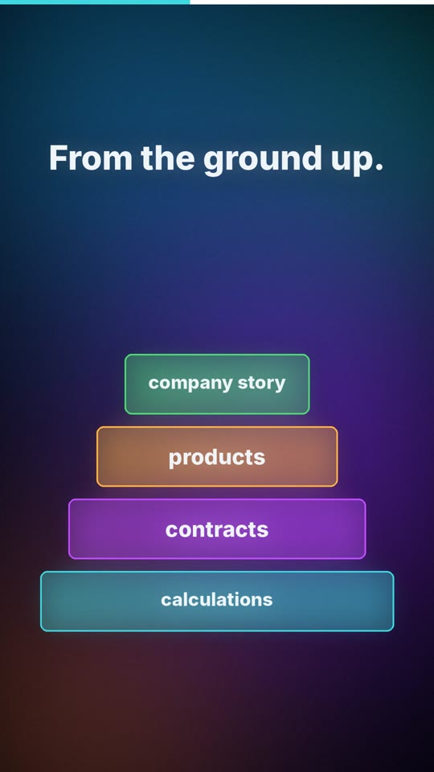

# 08 · Firma v Gitu / A company in Git

| | 🇨🇿 Česky | 🇬🇧 English |
|---|---|---|
| Video | [08-firma-v-gitu-CZ.mp4](08-firma-v-gitu-CZ.mp4) (48 s) | [08-a-company-in-git-EN.mp4](08-a-company-in-git-EN.mp4) (53 s) |
| Náhled |  |  |

**Myšlenka:** Malá firma v době AI: jeden repozitář v Gitu jako jediný zdroj pravdy, agent se v datech zorientuje a stavíte od základů nahoru; člověk dodává know-how a ptá se na kritický názor, Git hlídá každou změnu. Pak agent připraví materiály pro konkrétního zákazníka. Pro velkou firmu s mnoha lidmi je potřeba robustnější systém.

## Mluvený text

| Scéna | Česky | English |
|---|---|---|
| 1 | Jak dostat malou firmu do doby AI? | How do you bring a small business into the age of AI? |
| 2 | Založ jedno místo pro všechno. Repozitář v Gitu. Jeden zdroj pravdy. | Create one place for everything. A Git repository. A single source of truth. |
| 3 | Nahraj do něj data a nech agenta, ať se v nich zorientuje. Zeptej se ho, jestli je mu všechno jasné a kde vidí rozpory. | Put your data in and let the agent get its bearings. Ask it whether everything is clear, and where it sees contradictions. |
| 4 | Pak stavějte od základů nahoru. Výpočty, smlouvy, produkty, příběh firmy. | Then build from the ground up. Calculations, contracts, products, your company's story. |
| 5 | Celou dobu mu dodávej svoje know-how. A ptej se ho, co si o tom kriticky myslí. | Keep feeding it your know-how. And ask it what it honestly thinks. |
| 6 | Git hlídá každou změnu. Nic se neztratí a vždycky se dá vrátit zpět. | Git tracks every change. Nothing gets lost, and you can always go back. |
| 7 | Pak stačí zadat konkrétního zákazníka a agent připraví prezentaci, leták nebo kalkulačku přímo pro něj. | Then just name a specific customer, and the agent prepares a presentation, a flyer or a calculator made just for them. |
| 8 | Jen pozor: pro velkou firmu s mnoha lidmi už to nestačí. Tam je potřeba robustnější systém. | Just one catch: for a big company with many people, this isn't enough. That needs a more robust system. |

## Soubory

`zvuk/` nahrávky z ElevenLabs (Kuba / George) · `zdroj/make.py` scény · `zdroj/build.py` sestavení · `zdroj/casovani.json` časování řeči · `scenar.md` původní scénář

---

[← Naučná videa](../README.md)
