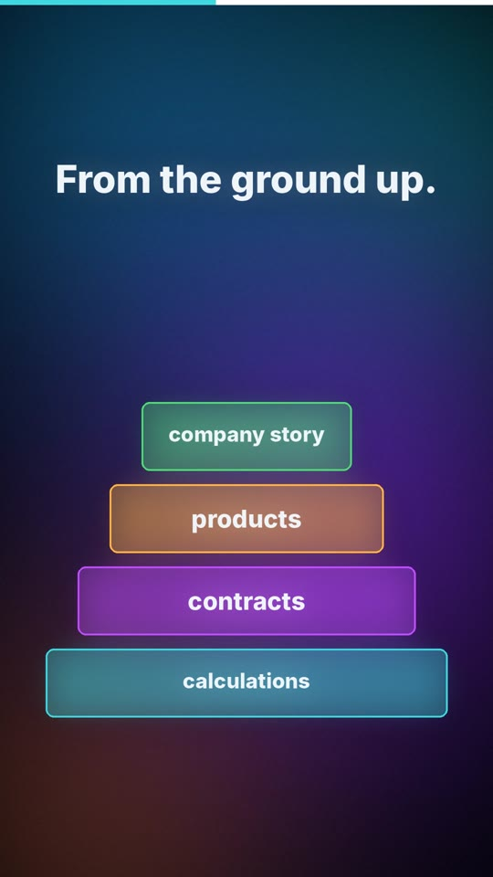

# 08 · Firma v Gitu / A company in Git / Una empresa en Git / Git में कंपनी

| | 🇨🇿 Česky | 🇬🇧 English | 🇪🇸 Español | 🇮🇳 हिन्दी |
|---|---|---|---|---|
| Video | [08-firma-v-gitu-CZ.mp4](08-firma-v-gitu-CZ.mp4) (48 s) | [08-a-company-in-git-EN.mp4](08-a-company-in-git-EN.mp4) (53 s) | [08-una-empresa-en-git-ES.mp4](08-una-empresa-en-git-ES.mp4) (57 s) | [08-git-mein-ek-company-HI.mp4](08-git-mein-ek-company-HI.mp4) (59 s) |
| Náhled |  |  |  |  |

**Myšlenka:** Malá firma v době AI: jeden repozitář v Gitu jako jediný zdroj pravdy, agent se v datech zorientuje a stavíte od základů nahoru; člověk dodává know-how a ptá se na kritický názor, Git hlídá každou změnu. Pak agent připraví materiály pro konkrétního zákazníka. Pro velkou firmu s mnoha lidmi je potřeba robustnější systém.

## Mluvený text

| Scéna | Česky | English | Español | हिन्दी |
|---|---|---|---|---|
| 1 | Jak dostat malou firmu do doby AI? | How do you bring a small business into the age of AI? | ¿Cómo llevas una pequeña empresa a la era de la IA? | एक छोटे बिज़नेस को एआई के दौर में कैसे लाएँ? |
| 2 | Založ jedno místo pro všechno. Repozitář v Gitu. Jeden zdroj pravdy. | Create one place for everything. A Git repository. A single source of truth. | Crea un solo lugar para todo. Un repositorio en Git. Una única fuente de verdad. | हर चीज़ के लिए एक जगह बनाइए। गिट में एक रिपॉज़िटरी। सच का एक ही स्रोत। |
| 3 | Nahraj do něj data a nech agenta, ať se v nich zorientuje. Zeptej se ho, jestli je mu všechno jasné a kde vidí rozpory. | Put your data in and let the agent get its bearings. Ask it whether everything is clear, and where it sees contradictions. | Sube tus datos y deja que el agente se oriente. Pregúntale si todo le queda claro y dónde ve contradicciones. | अपना डेटा उसमें डालिए और एजेंट को सब समझने दीजिए। उससे पूछिए कि क्या सब कुछ साफ़ है, और उसे कहाँ विरोधाभास दिखते हैं। |
| 4 | Pak stavějte od základů nahoru. Výpočty, smlouvy, produkty, příběh firmy. | Then build from the ground up. Calculations, contracts, products, your company's story. | Luego construye desde los cimientos hacia arriba. Cálculos, contratos, productos, la historia de tu empresa. | फिर नींव से ऊपर की ओर बनाइए। हिसाब-किताब, कॉन्ट्रैक्ट, प्रोडक्ट, आपकी कंपनी की कहानी। |
| 5 | Celou dobu mu dodávej svoje know-how. A ptej se ho, co si o tom kriticky myslí. | Keep feeding it your know-how. And ask it what it honestly thinks. | Durante todo el proceso, aporta tu experiencia. Y pregúntale qué opina de verdad, con espíritu crítico. | उसे लगातार अपना अनुभव देते रहिए। और उससे पूछिए कि वह ईमानदारी से क्या सोचता है। |
| 6 | Git hlídá každou změnu. Nic se neztratí a vždycky se dá vrátit zpět. | Git tracks every change. Nothing gets lost, and you can always go back. | Git registra cada cambio. Nada se pierde y siempre puedes volver atrás. | गिट हर बदलाव को दर्ज करता है। कुछ भी खोता नहीं, और आप हमेशा पीछे लौट सकते हैं। |
| 7 | Pak stačí zadat konkrétního zákazníka a agent připraví prezentaci, leták nebo kalkulačku přímo pro něj. | Then just name a specific customer, and the agent prepares a presentation, a flyer or a calculator made just for them. | Después basta con indicar un cliente concreto, y el agente prepara una presentación, un folleto o una calculadora hecha a su medida. | फिर बस किसी खास ग्राहक का नाम बताइए, और एजेंट उसके लिए प्रेज़ेंटेशन, पर्चा या कैलकुलेटर तैयार कर देता है। |
| 8 | Jen pozor: pro velkou firmu s mnoha lidmi už to nestačí. Tam je potřeba robustnější systém. | Just one catch: for a big company with many people, this isn't enough. That needs a more robust system. | Eso sí: para una gran empresa con mucha gente, esto ya no basta. Ahí hace falta un sistema más robusto. | बस एक बात: बहुत सारे लोगों वाली बड़ी कंपनी के लिए यह काफ़ी नहीं है। वहाँ ज़्यादा मज़बूत सिस्टम चाहिए। |

## Soubory

`zvuk/` nahrávky z ElevenLabs (Kuba / George / Brian C / Viraj; u nahrávek z workflow Namluvit i časy písmen v `*.casy.json`) · `zdroj/make.py` scény · `zdroj/build.py` sestavení · `zdroj/casovani.json` časování řeči · `scenar.md` původní scénář

---

[← Naučná videa](../README.md)
