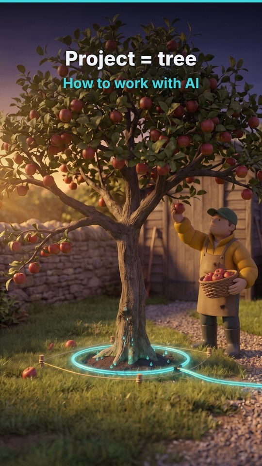
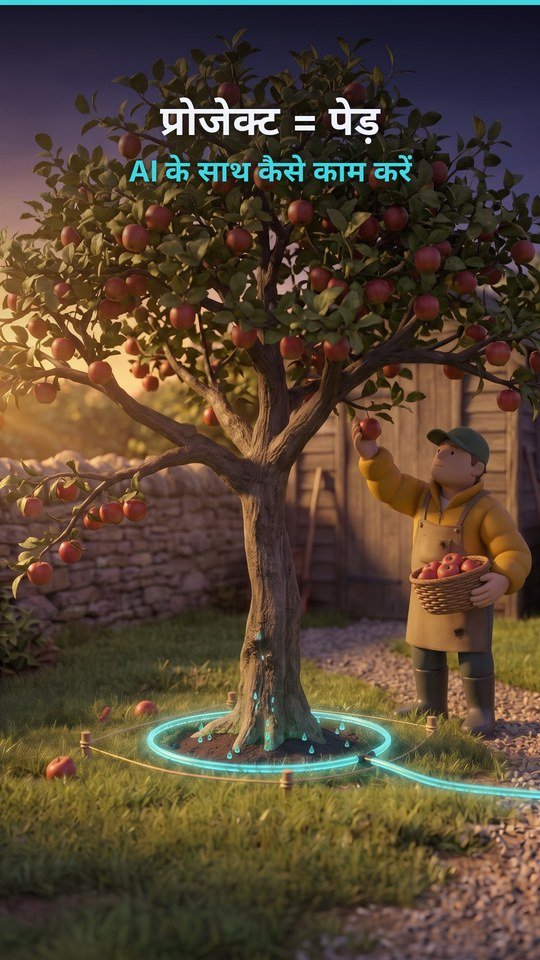

# 09 · Projekt je strom / Your project is a tree / Tu proyecto es un árbol / आपका प्रोजेक्ट एक पेड़ है

**Stav:** ✅ hotovo a zveřejněno na YouTube (CZ, EN, ES, HI – 21. 11. 2026)

| | 🇨🇿 Česky | 🇬🇧 English | 🇪🇸 Español | 🇮🇳 हिन्दी |
|---|---|---|---|---|
| Video | [09-projekt-je-strom-CZ.mp4](09-projekt-je-strom-CZ.mp4) (53 s) | [09-your-project-is-a-tree-EN.mp4](09-your-project-is-a-tree-EN.mp4) (57 s) | [09-tu-proyecto-es-un-arbol-ES.mp4](09-tu-proyecto-es-un-arbol-ES.mp4) (58 s) | [09-aapka-project-ek-ped-hai-HI.mp4](09-aapka-project-ek-ped-hai-HI.mp4) (70 s) |
| YouTube | [▶️ Short](https://www.youtube.com/shorts/xPLJMW0BRuA) | [▶️ Short](https://www.youtube.com/shorts/-ER7VNDV8ao) | [▶️ Short](https://www.youtube.com/shorts/Kgl1PG67J2w) | [▶️ Short](https://www.youtube.com/shorts/nR_pj6xu0_Y) |
| Náhled |  |  |  |  |

**Myšlenka:** Strom není AI, ale tvůj projekt. AI je zavlažování a hnojení – strom díky ní roste sám a rychle. Člověk stříhá (určuje směr) a hlídá škůdce (když AI ztratí nit, připomene jí cíl). Bez plánu v malém květináči se pořád přesazuje – každé přesazení je přestavba projektu. S plánem a zkouškou na začátku se zasadí jednou a strom plodí.

**Obraz:** generované záběry – klíčové snímky z Gemini (Nano Banana), videoklipy v Gemini, složení s popisky a ukazatelem průběhu v `zdroj/make.py`. Jediné, co svítí, je tyrkysové zavlažování = AI.

## Mluvený text

| Scéna | Česky | English | Español |
|---|---|---|---|
| 1 | Představ si, že tvůj projekt je strom. Bez AI nosíš každou konev sám. Roste, ale pomalu. | Imagine your project is a tree. Without AI, you carry every watering can yourself. It grows, but slowly. | Imagina que tu proyecto es un árbol. Sin IA, cargas tú cada regadera. Crece, pero despacio. |
| 2 | S AI se zalévá a hnojí sám. Roste tak rychle, že to skoro nestíháš sledovat. | With AI, it waters and feeds itself. It grows so fast you can barely keep up. | Con IA, se riega y se abona solo. Crece tan rápido que casi no puedes seguirlo. |
| 3 | Tobě zbývá stříhat. Ty určuješ, kterým směrem poroste. | Your job is pruning. You decide which way it grows. | A ti te toca podar. Tú decides hacia dónde crece. |
| 4 | A hlídat škůdce. Když AI ztratí nit a táhne jinam, připomeň jí, o co jde. | And keeping pests away. When the AI loses the thread and drifts, remind it what this is about. | Y vigilar las plagas. Cuando la IA pierde el hilo y se desvía, recuérdale de qué se trata. |
| 5 | Jenže když začneš bez plánu v malém květináči, strom ho brzy přeroste. Přesadíš ho. A znovu. A znovu. | Start small, with no plan, and the tree soon outgrows its pot. You repot it. And again. And again. | Pero si empiezas sin plan, en una maceta diminuta, pronto se le queda pequeña. Lo trasplantas. Y otra vez. Y otra vez. |
| 6 | Každé přesazení je přestavba celého projektu. Strom místo růstu jen přežívá. | Every repotting means rebuilding the whole project. Instead of growing, the tree just survives. | Cada trasplante es rehacer todo el proyecto. En vez de crecer, el árbol solo sobrevive. |
| 7 | Když si ale všechno nejdřív naplánuješ a vyzkoušíš, zasadíš ho jen jednou. Rovnou tam, kde má prostor. | Plan and test first, and you plant it just once. Right where it has room to grow. | Pero si primero lo planeas y lo pruebas todo, lo plantas una sola vez. Justo donde tiene espacio para crecer. |
| 8 | Pak doroste hned a začne plodit. AI zalévá. Kam strom zasadíš, rozhoduješ ty. | Then it thrives right away and bears fruit. AI does the watering. Where you plant it is up to you. | Entonces crece enseguida y empieza a dar frutos. La IA riega. Dónde plantas el árbol, lo decides tú. |

## Soubory

`obrazky/` klíčové snímky K01–K12 · `klipy/` videoklipy V1–V8 · `zvuk/` nahrávky z ElevenLabs (Kuba / George / Brian C / Viraj; hindský text je ve [scénáři](scenar.md)) · `zdroj/make.py` složení (náhled, render, náhledy) · `zdroj/casovani.json` časování řeči · [`scenar.md`](scenar.md) prompty a postup

---

[← Naučná videa](../README.md)
