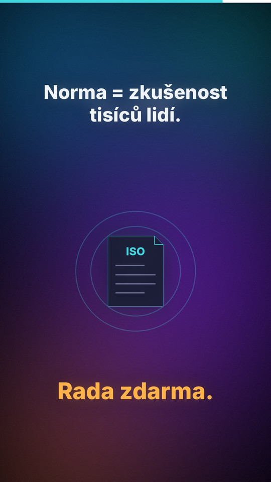
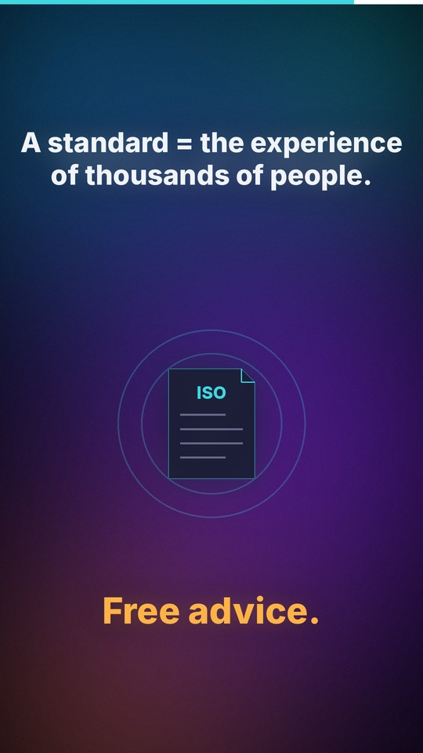
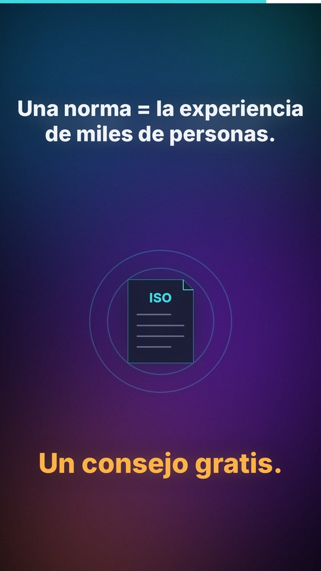
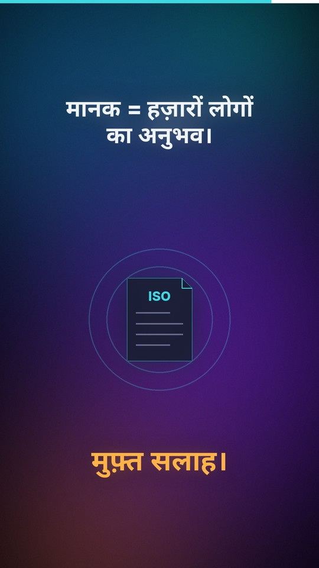
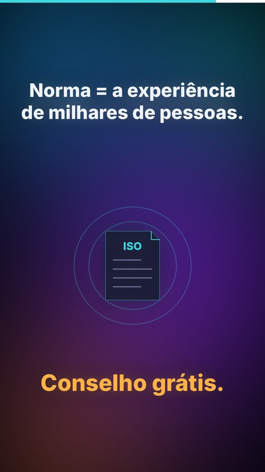

# 10 · Normy jako rady zdarma / Standards as free advice / Normas como consejos gratis / मानक: मुफ़्त सलाह / Normas como conselhos grátis

| | 🇨🇿 Česky | 🇬🇧 English | 🇪🇸 Español | 🇮🇳 हिन्दी | 🇧🇷 Português |
|---|---|---|---|---|---|
| Video | [10-normy-jako-rady-zdarma-CZ.mp4](10-normy-jako-rady-zdarma-CZ.mp4) (34 s) | [10-standards-as-free-advice-EN.mp4](10-standards-as-free-advice-EN.mp4) (36 s) | [10-normas-como-consejos-gratis-ES.mp4](10-normas-como-consejos-gratis-ES.mp4) (37 s) | [10-maanak-muft-salaah-HI.mp4](10-maanak-muft-salaah-HI.mp4) (39 s) | [10-normas-como-conselhos-gratis-PT.mp4](10-normas-como-conselhos-gratis-PT.mp4) (33 s) |
| Náhled |  |  |  |  |  |

**Myšlenka:** Normy, dřív dlouhé texty a bolení hlavy, jsou s AI rady zdarma: stačí říct „udělejme to podle ISO 9001 a mysli na zaměstnance“, čísla norem ani znát nemusíš. Norma je zhuštěná zkušenost tisíců lidí a na certifikaci jsi připravený od začátku.

**Vychází z:** [Část druhá, kap. 6 Normy jako rady zdarma](../../Část%20druhá/kapitoly/06-normy-jako-rady-zdarma.md)

## Mluvený text

| Scéna | Česky | English | Español | हिन्दी | Português |
|---|---|---|---|---|---|
| 1 | Normy. Dlouhé texty, které nikdo nechce číst? | Standards. Long documents nobody wants to read? | Normas. ¿Textos largos que nadie quiere leer? | मानक। लंबे दस्तावेज़, जिन्हें कोई पढ़ना नहीं चाहता? | Normas. Textos longos que ninguém quer ler? |
| 2 | Dřív platilo: čím víc norem, tím víc bolení hlavy. | It used to be: the more standards, the more headaches. | Antes era así: cuantas más normas, más dolores de cabeza. | पहले ऐसा था: जितने ज़्यादा मानक, उतना ज़्यादा सिरदर्द। | Antes era assim: quanto mais normas, mais dor de cabeça. |
| 3 | S AI je to naopak. Řekni jí: udělejme to podle normy ISO devět tisíc jedna. A mysli i na zaměstnance. | With AI, it's the other way round. Tell it: let's do this by ISO 9001. And keep the employees in mind too. | Con la IA es al revés. Dile: hagámoslo según la norma ISO 9001. Y piensa también en los empleados. | एआई के साथ उल्टा है। उससे कहिए: इसे आईएसओ नौ हज़ार एक के हिसाब से करते हैं। और कर्मचारियों का भी ध्यान रखो। | Com a IA, é o contrário. Diga a ela: vamos fazer isso segundo a ISO 9001. E pense também nos funcionários. |
| 4 | Čísla norem ani nemusíš znát. Stačí se zeptat, které se na tvůj úkol hodí. | You don't even need to know the numbers. Just ask which ones fit your task. | Ni siquiera necesitas saber los números. Basta con preguntar cuáles sirven para tu tarea. | आपको नंबर जानने की भी ज़रूरत नहीं। बस पूछिए कि आपके काम के लिए कौन-से मानक सही हैं। | Você nem precisa saber os números. Basta perguntar quais servem para a sua tarefa. |
| 5 | Norma je vlastně zhuštěná zkušenost tisíců lidí. Rada zdarma, kterou AI umí použít. | A standard is really the condensed experience of thousands of people. Free advice that AI knows how to use. | En el fondo, una norma es la experiencia condensada de miles de personas. Un consejo gratis que la IA sabe usar. | असल में मानक हज़ारों लोगों का निचोड़ा हुआ अनुभव है। मुफ़्त सलाह, जिसे एआई इस्तेमाल करना जानता है। | No fundo, uma norma é a experiência condensada de milhares de pessoas. Um conselho grátis que a IA sabe usar. |
| 6 | A kdybys jednou chtěl certifikaci, jsi na ni připravený od začátku. | And if you ever want certification, you're ready for it from the start. | Y si algún día quieres certificarte, estás preparado desde el principio. | और अगर कभी सर्टिफ़िकेशन चाहिए, तो आप शुरुआत से ही तैयार हैं। | E se um dia você quiser uma certificação, já está preparado desde o começo. |

## Soubory

`texty.md` mluvené texty pro workflow Namluvit · `zvuk/` nahrávky z ElevenLabs (Kuba / George / Brian C / Viraj / Zozo) s časy písmen v `*.casy.json` · `zdroj/make.py` scény (časy popisků z kotevních slov) · `zdroj/build.py` sestavení · `zdroj/casovani.json` časování řeči

---

[← Naučná videa](../README.md)
