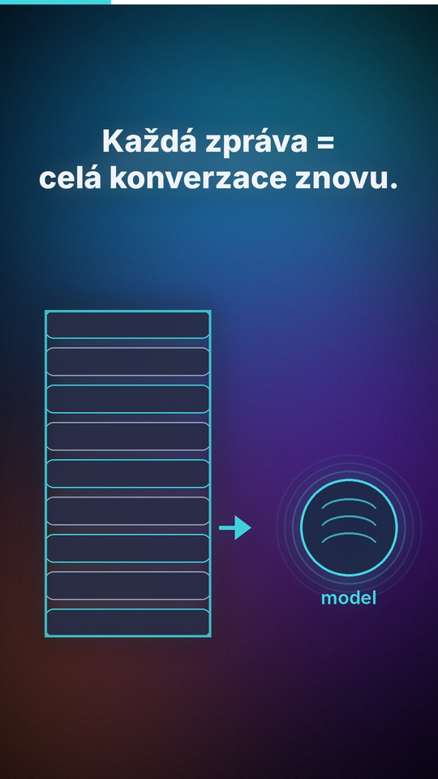
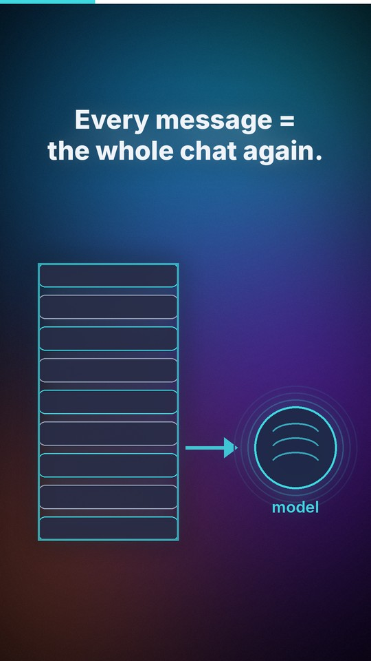
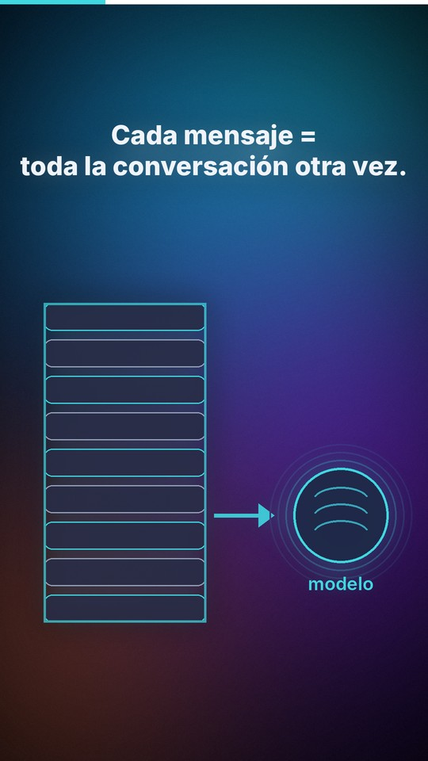
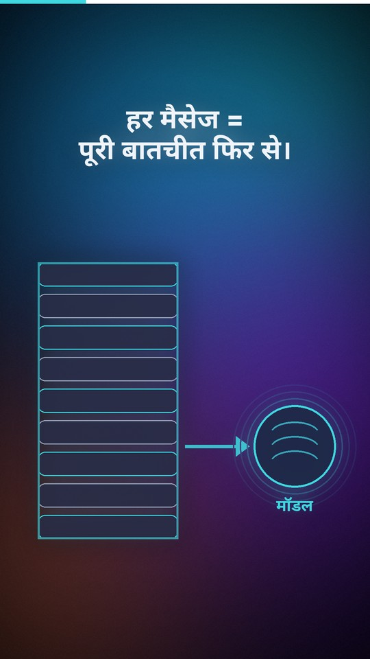
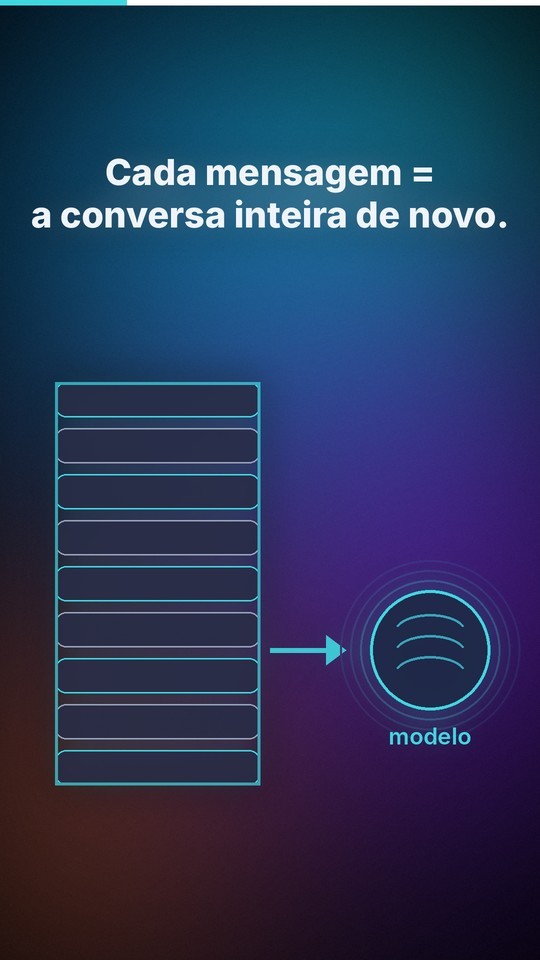

# 11 · Proč AI v dlouhém chatu chybuje / Why AI slips in long chats / Por qué la IA falla en chats largos / लंबी चैट में AI क्यों चूकता है / Por que a IA erra em chats longos

| | 🇨🇿 Česky | 🇬🇧 English | 🇪🇸 Español | 🇮🇳 हिन्दी | 🇧🇷 Português |
|---|---|---|---|---|---|
| Video | [11-proc-ai-v-dlouhem-chatu-chybuje-CZ.mp4](11-proc-ai-v-dlouhem-chatu-chybuje-CZ.mp4) (? s) | [11-why-ai-slips-in-long-chats-EN.mp4](11-why-ai-slips-in-long-chats-EN.mp4) (? s) | [11-por-que-la-ia-falla-en-chats-largos-ES.mp4](11-por-que-la-ia-falla-en-chats-largos-ES.mp4) (? s) | [11-lambi-chat-mein-ai-kyon-chookta-hai-HI.mp4](11-lambi-chat-mein-ai-kyon-chookta-hai-HI.mp4) (? s) | [11-por-que-a-ia-erra-em-chats-longos-PT.mp4](11-por-que-a-ia-erra-em-chats-longos-PT.mp4) (? s) |
| Náhled |  |  |  |  |  |

**Myšlenka:** V dlouhém chatu jde s každou zprávou do modelu celá konverzace, hromadí se protiklady a při zkracování může vypadnout důležitá věc. Pomůže nový chat s krátkými poznámkami – krátký a čistý kontext je lepší než dlouhý a zamotaný.

**Vychází z:** [Část první, kap. 2 Přemýšlení](../../Část%20první/kapitoly/02-premysleni.md)

## Mluvený text

| Scéna | Česky | English | Español | हिन्दी | Português |
|---|---|---|---|---|---|
| 1 | Proč AI v dlouhém chatu začne dělat chyby? | Why does AI start making mistakes in a long chat? | ¿Por qué la IA empieza a equivocarse en un chat largo? | लंबी चैट में एआई गलतियाँ क्यों करने लगता है? | Por que a IA começa a errar num chat longo? |
| 2 | S každou zprávou do ní jde znovu celá konverzace. Všechno, co jste si kdy napsali. | With every message, the whole conversation goes back in. Everything you've ever written to each other. | Con cada mensaje, le vuelve a entrar toda la conversación. Todo lo que se han escrito. | हर मैसेज के साथ पूरी बातचीत फिर से उसमें जाती है। जो कुछ भी आपने कभी लिखा है। | A cada mensagem, a conversa inteira entra de novo nela. Tudo o que vocês já escreveram. |
| 3 | Jenže v dlouhém chatu se hromadí protiklady. Napřed jsi chtěl modrou, pak zelenou. Model neví, co platí. | But in a long chat, contradictions pile up. First you wanted blue, then green. The model doesn't know which one counts. | Pero en un chat largo se acumulan contradicciones. Primero querías azul, luego verde. El modelo no sabe qué vale. | लेकिन लंबी चैट में विरोधाभास जमा हो जाते हैं। पहले आप नीला चाहते थे, फिर हरा। मॉडल को नहीं पता कि कौन-सा सही है। | Só que num chat longo as contradições se acumulam. Primeiro você queria azul, depois verde. O modelo não sabe o que vale. |
| 4 | A když se konverzace nevejde do paměti, zkrátí se. Při zkracování může vypadnout důležitá věc. | And when the conversation no longer fits in its memory, it gets shortened. Something important can fall out. | Y cuando la conversación ya no cabe en su memoria, se recorta. Y algo importante puede quedarse fuera. | और जब बातचीत उसकी याददाश्त में नहीं समाती, तो उसे छोटा कर दिया जाता है। इसमें कोई ज़रूरी बात छूट सकती है। | E quando a conversa não cabe mais na memória dele, ela é encurtada. Algo importante pode ficar de fora. |
| 5 | Pomůže začít nový chat. Důležité věci si drž v krátkých poznámkách a ty mu dej na začátek. | It helps to start a new chat. Keep the important things in short notes, and give them to it at the start. | Ayuda empezar un chat nuevo. Guarda lo importante en notas cortas y dáselas al principio. | नई चैट शुरू करने से मदद मिलती है। ज़रूरी बातें छोटे नोट्स में रखिए, और शुरुआत में उसे दे दीजिए। | Ajuda começar um chat novo. Guarde o que é importante em notas curtas e entregue a ele no começo. |
| 6 | Krátký a čistý kontext je lepší než dlouhý a zamotaný. | A short, clean context beats a long, tangled one. | Un contexto corto y limpio es mejor que uno largo y enredado. | छोटा और साफ़ संदर्भ, लंबे और उलझे हुए संदर्भ से बेहतर है। | Um contexto curto e limpo é melhor do que um longo e embolado. |

## Soubory

`texty.md` mluvené texty pro workflow Namluvit · `zvuk/` nahrávky z ElevenLabs (Kuba / George / Brian C / Viraj / Zozo) s časy písmen v `*.casy.json` · `zdroj/make.py` scény (časy popisků z kotevních slov) · `zdroj/build.py` sestavení · `zdroj/casovani.json` časování řeči

---

[← Naučná videa](../README.md)
