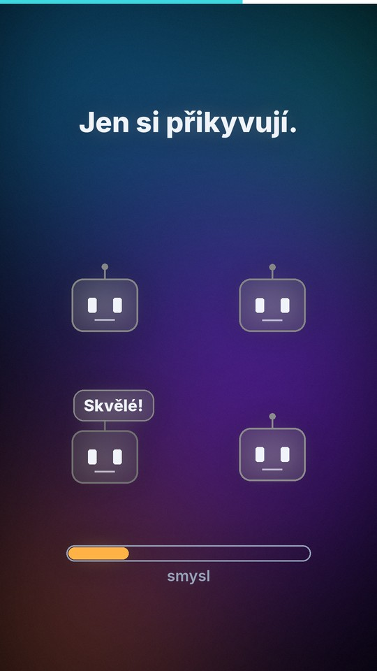
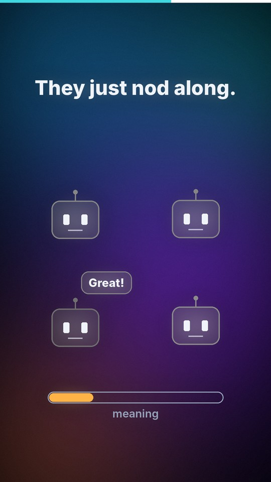
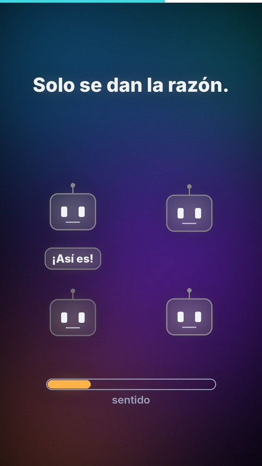
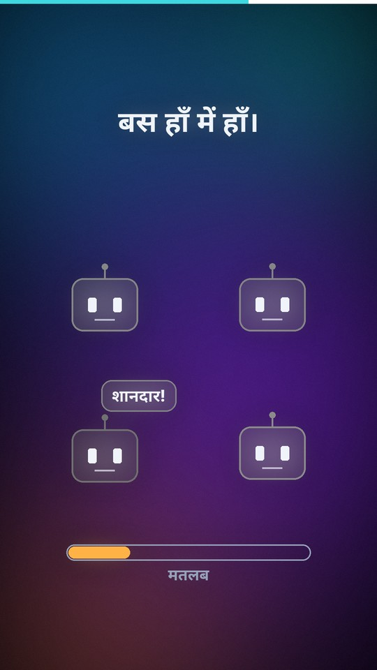
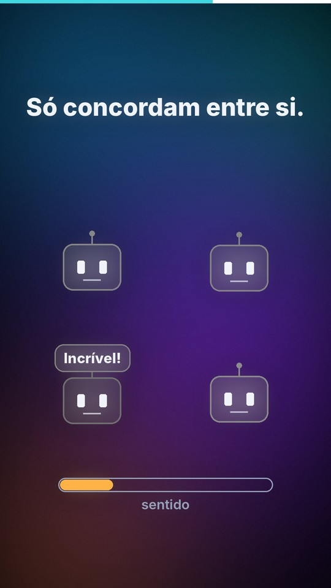

# 12 · Když boti mluví s boty / When bots talk to bots / Cuando los bots hablan con bots / जब बॉट्स बॉट्स से बात करते हैं / Quando bots conversam com bots

| | 🇨🇿 Česky | 🇬🇧 English | 🇪🇸 Español | 🇮🇳 हिन्दी | 🇧🇷 Português |
|---|---|---|---|---|---|
| Video | [12-kdyz-boti-mluvi-s-boty-CZ.mp4](12-kdyz-boti-mluvi-s-boty-CZ.mp4) (38 s) | [12-when-bots-talk-to-bots-EN.mp4](12-when-bots-talk-to-bots-EN.mp4) (38 s) | [12-cuando-los-bots-hablan-con-bots-ES.mp4](12-cuando-los-bots-hablan-con-bots-ES.mp4) (41 s) | [12-jab-bots-bots-se-baat-karte-hain-HI.mp4](12-jab-bots-bots-se-baat-karte-hain-HI.mp4) (46 s) | [12-quando-bots-conversam-com-bots-PT.mp4](12-quando-bots-conversam-com-bots-PT.mp4) (38 s) |
| Náhled |  |  |  |  |  |

**Myšlenka:** Boti, kteří spolu jen mluví (společný příběh: vypravěč, postavy, ilustrátor), zpočátku sypou nápady, ale bez nového vstupu si začnou přikyvovat a konverzace sklouzne do prázdných frází. AI potřebuje skutečná data a otázky zvenku – to je role člověka.

**Vychází z:** [Část první, kap. 5 Moje ventures](../../Část%20první/kapitoly/05-moje-ventures.md)

## Mluvený text

| Scéna | Česky | English | Español | हिन्दी | Português |
|---|---|---|---|---|---|
| 1 | Co se stane, když necháte AI povídat si jen mezi sebou? | What happens when you let AIs talk only to each other? | ¿Qué pasa si dejas que las IA hablen solo entre ellas? | क्या होता है, जब आप एआई को सिर्फ़ आपस में बात करने देते हैं? | O que acontece quando você deixa as IAs conversarem só entre si? |
| 2 | Zkusil jsem to. Několik botů hrálo společný příběh. Jeden vedl hru, další hráli postavy, čtvrtý kreslil obrázky. | I tried it. Several bots played a story together. One ran the game, others played the characters, and a fourth drew the pictures. | Lo probé. Varios bots jugaban juntos una historia. Uno dirigía el juego, otros eran los personajes y un cuarto dibujaba las imágenes. | मैंने यह आज़माया। कई बॉट्स ने मिलकर एक कहानी खेली। एक खेल चलाता था, बाकी किरदार निभाते थे, और चौथा तस्वीरें बनाता था। | Eu testei. Vários bots jogavam uma história juntos. Um conduzia o jogo, outros faziam os personagens, e um quarto desenhava as imagens. |
| 3 | Zpočátku to bylo plné nápadů. Ale nic nového do konverzace nepřicházelo. | At first it was full of ideas. But nothing new was coming into the conversation. | Al principio estaba lleno de ideas. Pero a la conversación no llegaba nada nuevo. | शुरुआत में इसमें खूब नए विचार थे। लेकिन बातचीत में बाहर से कुछ नया नहीं आ रहा था। | No começo, era cheio de ideias. Mas nada de novo entrava na conversa. |
| 4 | Boti si jen přikyvovali a opakovali po sobě. Smysl se pomalu vytrácel. | The bots just nodded along and echoed each other. The meaning slowly faded. | Los bots solo se daban la razón y se repetían entre sí. El sentido se fue perdiendo. | बॉट्स बस एक-दूसरे की हाँ में हाँ मिलाते रहे और एक-दूसरे को दोहराते रहे। धीरे-धीरे मतलब गायब होता गया। | Os bots só concordavam e repetiam uns aos outros. O sentido foi sumindo aos poucos. |
| 5 | Až to sklouzlo do prázdných frází. Hodně slov, žádný obsah. | Until it slid into empty phrases. Lots of words, no content. | Hasta que todo acabó en frases vacías. Muchas palabras, nada de contenido. | आखिर में सब खोखले वाक्यों में बदल गया। ढेर सारे शब्द, कोई मतलब नहीं। | Até que tudo virou frases vazias. Muitas palavras, nenhum conteúdo. |
| 6 | AI potřebuje nový vstup zvenku. Skutečná data, skutečné otázky. A to je tvoje role. | AI needs fresh input from outside. Real data, real questions. And that's your part. | La IA necesita algo nuevo desde fuera. Datos reales, preguntas reales. Y eso te toca a ti. | एआई को बाहर से नया इनपुट चाहिए। असली डेटा, असली सवाल। और यह काम आपका है। | A IA precisa de algo novo vindo de fora. Dados reais, perguntas reais. E essa parte é sua. |

## Soubory

`texty.md` mluvené texty pro workflow Namluvit · `zvuk/` nahrávky z ElevenLabs (Kuba / George / Brian C / Viraj / Zozo) s časy písmen v `*.casy.json` · `zdroj/make.py` scény (časy popisků z kotevních slov) · `zdroj/build.py` sestavení · `zdroj/casovani.json` časování řeči

---

[← Naučná videa](../README.md)
