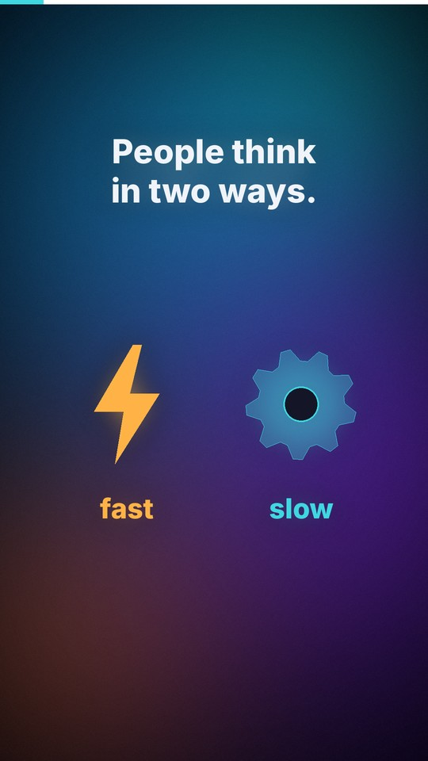
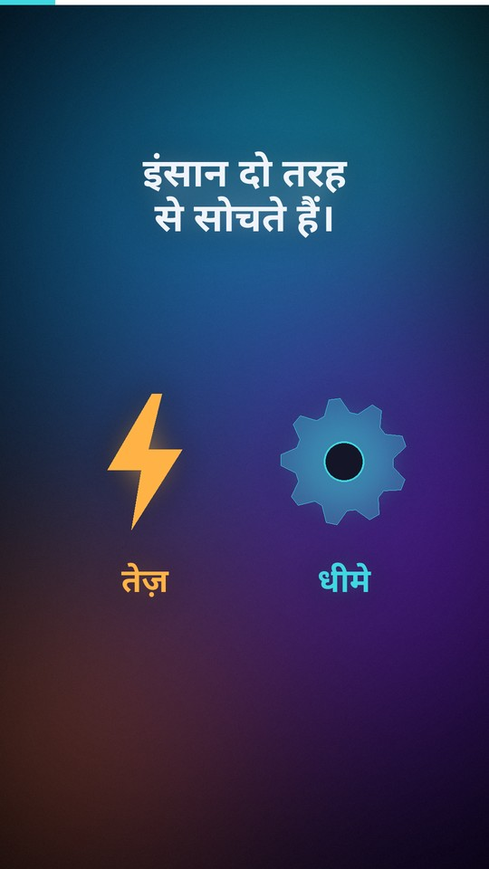
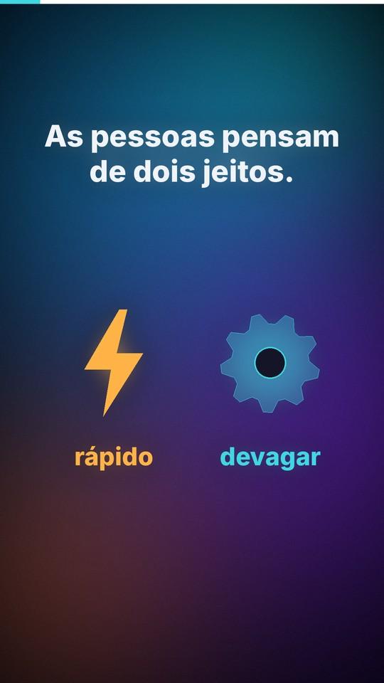

# 13 · Myšlení rychlé a pomalé / Thinking fast and slow / Pensar rápido y despacio / तेज़ सोच और धीमी सोच / Pensar rápido e devagar

| | 🇨🇿 Česky | 🇬🇧 English | 🇪🇸 Español | 🇮🇳 हिन्दी | 🇧🇷 Português |
|---|---|---|---|---|---|
| Video | [13-mysleni-rychle-a-pomale-CZ.mp4](13-mysleni-rychle-a-pomale-CZ.mp4) (? s) | [13-thinking-fast-and-slow-EN.mp4](13-thinking-fast-and-slow-EN.mp4) (? s) | [13-pensar-rapido-y-despacio-ES.mp4](13-pensar-rapido-y-despacio-ES.mp4) (? s) | [13-tez-soch-aur-dheemi-soch-HI.mp4](13-tez-soch-aur-dheemi-soch-HI.mp4) (? s) | [13-pensar-rapido-e-devagar-PT.mp4](13-pensar-rapido-e-devagar-PT.mp4) (? s) |
| Náhled |  |  |  |  |  |

**Myšlenka:** Lidé myslí rychle (hned, ale často vedle) a pomalu (počítá, ověřuje, zvažuje – a rádi se mu vyhneme). Dřív jsme pomalé myšlení přenechávali vyhledávači, teď ho můžeme přenechat celé AI. Kdo ale přestane myslet pomalu sám, nepozná, kdy se AI mýlí: dřinu nech AI, úsudek si nech.

**Vychází z:** [Část druhá, kap. 2 Myšlení rychlé a pomalé](../../Část%20druhá/kapitoly/02-mysleni-rychle-a-pomale.md)

## Mluvený text

| Scéna | Česky | English | Español | हिन्दी | Português |
|---|---|---|---|---|---|
| 1 | Lidé myslí dvěma způsoby. Rychle a pomalu. | People think in two ways. Fast and slow. | Las personas piensan de dos maneras. Rápido y despacio. | इंसान दो तरह से सोचते हैं। तेज़ी से और धीरे-धीरे। | As pessoas pensam de dois jeitos. Rápido e devagar. |
| 2 | Rychlé myšlení je automatické. Odpoví hned, ale často se splete. | Fast thinking is automatic. It answers right away, but it's often wrong. | El pensamiento rápido es automático. Responde enseguida, pero a menudo se equivoca. | तेज़ सोच अपने आप चलती है। वह तुरंत जवाब देती है, लेकिन अक्सर गलत होती है। | O pensamento rápido é automático. Responde na hora, mas muitas vezes erra. |
| 3 | Pomalé myšlení je namáhavé. Počítá, ověřuje, zvažuje. A většina lidí se mu ráda vyhne. | Slow thinking takes effort. It calculates, checks, weighs things up. And most people happily avoid it. | El pensamiento lento cuesta. Calcula, verifica, sopesa. Y la mayoría de la gente lo evita con gusto. | धीमी सोच में मेहनत लगती है। वह हिसाब लगाती है, जाँचती है, तौलती है। और ज़्यादातर लोग उससे खुशी-खुशी बचते हैं। | O pensamento lento dá trabalho. Calcula, confere, pondera. E a maioria das pessoas evita isso de bom grado. |
| 4 | Dřív jsme ho přenechávali vyhledávači. Teď ho můžeme přenechat celé AI. | We used to hand it off to a search engine. Now we can hand all of it to AI. | Antes se lo dejábamos al buscador. Ahora se lo podemos dejar todo a la IA. | पहले हम यह काम सर्च इंजन को सौंप देते थे। अब हम पूरा का पूरा एआई को सौंप सकते हैं। | Antes, a gente passava isso para o buscador. Agora dá para passar tudo para a IA. |
| 5 | Jenže kdo přestane přemýšlet pomalu sám, nepozná, kdy se AI mýlí. | But if you stop thinking slowly yourself, you won't notice when the AI is wrong. | Pero si dejas de pensar despacio por tu cuenta, no notarás cuándo se equivoca la IA. | लेकिन अगर आप खुद धीरे सोचना छोड़ देंगे, तो आपको पता नहीं चलेगा कि एआई कब गलत है। | Mas se você deixa de pensar devagar por conta própria, não vai perceber quando a IA erra. |
| 6 | Nech AI udělat tu dřinu. Ale úsudek si nech. Pomalé myšlení je pořád tvoje. | Let AI do the heavy lifting. But keep the judgment. Slow thinking is still yours. | Deja que la IA haga el trabajo pesado. Pero quédate con el criterio. El pensamiento lento sigue siendo tuyo. | मेहनत वाला काम एआई को करने दीजिए। लेकिन फ़ैसला अपने पास रखिए। धीमी सोच अब भी आपकी है। | Deixe a IA fazer o trabalho pesado. Mas fique com o julgamento. O pensamento lento continua sendo seu. |

## Soubory

`texty.md` mluvené texty pro workflow Namluvit · `zvuk/` nahrávky z ElevenLabs (Kuba / George / Brian C / Viraj / Zozo) s časy písmen v `*.casy.json` · `zdroj/make.py` scény (časy popisků z kotevních slov) · `zdroj/build.py` sestavení · `zdroj/casovani.json` časování řeči

---

[← Naučná videa](../README.md)
