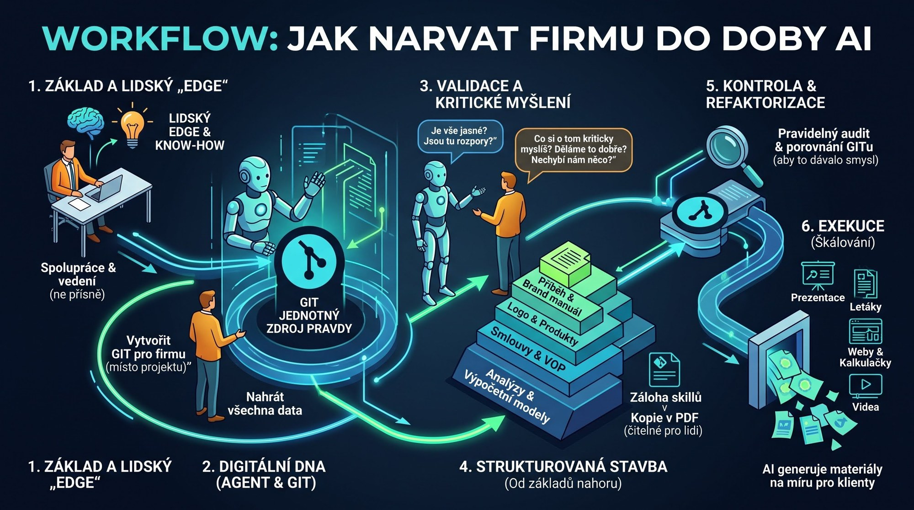

# 4. Workflow: jak narvat firmu do doby AI

*Workflow company as context* za použití *single source of truth* aneb jak narvat firmu do doby AI. Bude to asi validní pro firmy o 1–2 zaměstnancích:

1. Používat agentní systém.
2. Vytvořit Git, popsat mu, o co jde – klidně jako firmu místo projektu.
3. Narvat mu data.
4. Doptat se ho, jestli je vše jasné, případně jestli tam jsou nějaké rozpory.
5. Nebát se ptát, co si o tom kriticky myslí, jestli to děláme dobře, jestli nám něco nechybí.
6. Stavět to strukturovaně od základů nahoru.
7. Celou dobu mu je nutné dodávat svoje know-how, svůj edge, vést ho, ale ne přísně, spolupracovat, vyměňovat si myšlenky.
8. Říct mu, ať si na Git zálohuje i skilly.
9. Říct mu, ať u důležitých dokumentů vede i kopii v PDF čitelnou pro lidi.
10. Říct mu, ať jednou za čas projde a porovná Git tak, aby to dávalo smysl.

Postupně strukturovaně tvoříme dokumenty: logo, logo manuál, brand manuál, checklist pro obchodníky, příběh firmy, popis produktů, web, záruční a obchodní podmínky, marketingové dokumenty… Pokud je to technické, tak ke všemu i analýzy a výpočetní modely.

Pak už mi nic nebrání dát mu třeba konkrétní obchodní případ – a on udělá prezentace, letáky, interaktivní webové kalkulačky, videa přesně pro ně.

---

[← Filozofická vsuvka: Záblesk na sirce](03a-vsuvka-zablesk-na-sirce.md) · [Obsah](../01-obsah.md) · [5. Práce je hra →](05-prace-je-hra.md)
